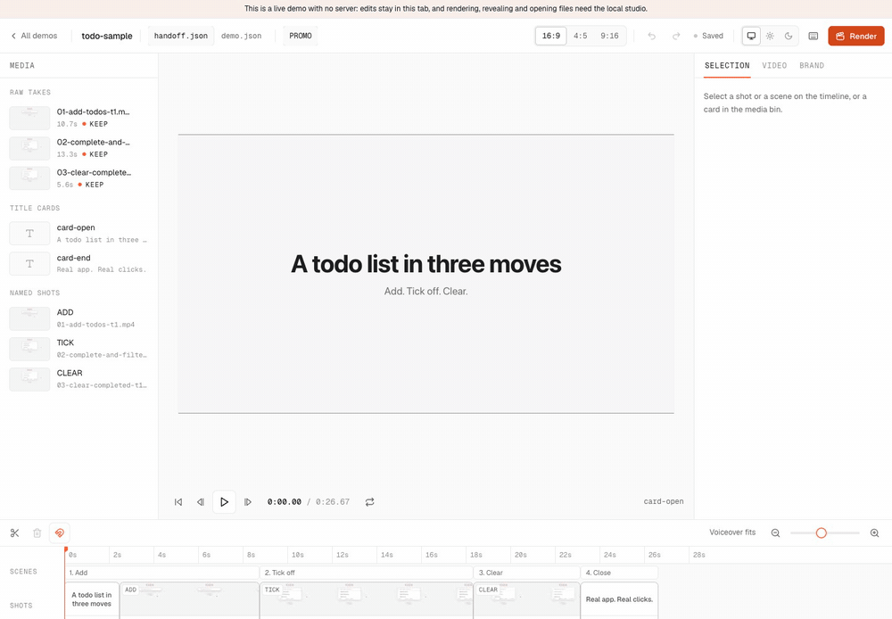

<p align="center">
  
</p>

<h1 align="center">demo-studio</h1>

<p align="center">
  <b>Tell your coding agent the goal. Get a finished demo video of your real app.</b>
</p>

<p align="center">
  <a href="https://github.com/cyruspastelero/demo-studio/actions/workflows/ci.yml"></a>
  <a href="LICENSE"></a>
  
</p>

<p align="center">
  <a href="https://demo-studio.pastelero.ph/"><b>Live demo</b></a>
  &nbsp;·&nbsp;
  <a href="#quick-start"><b>Quick start</b></a>
  &nbsp;·&nbsp;
  <a href="#docs"><b>Docs</b></a>
</p>

Skills for your coding agent that turn your real product into a finished demo video. They work with
Claude Code, Codex, Cursor, Gemini CLI, GitHub Copilot and other agents that read skills or `AGENTS.md`.

**How it works**

1. Tell your agent what the video should show.
2. Log in to a test account in the Playwright browser, or hand over demo credentials.
3. The agent writes the plan and shows it to you. Nothing is recorded until you say go.
   If you want, it first draws a storyboard: every scene in the final look, in your product's font
   and colours, with a box on each one for your notes.
4. It tests the flow, records the product, then cuts and narrates the video.

After you approve the plan, it only stops to ask for a login code, or before a step that would cost
money or create something it can't delete.

- **Real footage.** Every frame is your product running. No AI-generated footage.
- **Local and free.** It runs on your machine with free tools. Paid voices and music are optional.
- **Safe.** Test accounts only, and secrets are masked before anything is captured.
  [More](#local-and-safe)
- **Polished by default.** Every cut is checked before you see it: the main cut against a
  [measured quality bar](docs/quality-bar.md), every other cut for blank or frozen stretches, and the
  plan for numbers on screen that the voiceover doesn't say.

## Sample videos

Real apps, finished by the plugin. Click a preview to watch it in 1080p with sound.

| Study app showcase (1:27) | Todo app sample (0:37) |
| --- | --- |
| [](https://github.com/cyruspastelero/demo-studio/releases/download/samples/sample-showcase.mp4) | [](https://github.com/cyruspastelero/demo-studio/releases/download/samples/sample-todo.mp4) |
| A live study app with a seeded demo learner. | [TodoMVC](https://todomvc.com), three scenes, no login. [Rebuild it yourself](examples/todo-sample). |

**Launch videos**, also made with demo-studio:

| demo-studio launch ad (0:36) | demo-studio walkthrough (1:30) | Switchyard launch ad (0:36) |
| --- | --- | --- |
| [](https://github.com/cyruspastelero/demo-studio/releases/download/samples/sample-launch-ad.mp4) | [](https://github.com/cyruspastelero/demo-studio/releases/download/samples/sample-launch.mp4) | [](https://github.com/cyruspastelero/demo-studio/releases/download/samples/sample-daylight-ad.mp4) |
| `midnight-ad` style, made with `demo-motion`. [Its storyboard](examples/launch-ad) | Narrated. [Files](examples/demo-studio-launch) | `daylight` style, for [Switchyard](https://github.com/cyruspastelero/switchyard). [Files](examples/switchyard-launch) |

## Quick start

**The fast way: paste this into your coding agent** (Claude Code, Codex, Cursor, Gemini CLI, Copilot
or any other) and it sets everything up:

```text
Set up demo-studio for me so I can make product demo videos.
1. Clone https://github.com/cyruspastelero/demo-studio.git and work inside that folder.
2. Check for Node.js 20+, Python 3.10+, ffmpeg and Google Chrome. Ask me before installing anything that is missing.
3. Run npm install, then bash scripts/doctor.sh, and fix what it reports.
4. Add the Playwright MCP server to your MCP settings. Command: npx -y @playwright/mcp@0.0.84 --browser chrome
5. Run bash scripts/new-workspace.sh ./demos
6. Tell me if I need to restart you to load the browser tool, then how to start my first demo.
```

**Or step by step:**

**1. Install the tools** (macOS; for Linux and Windows see [getting started](docs/getting-started.md)):

```bash
brew install node ffmpeg python
brew install --cask google-chrome
```

**2. Give your agent a browser it can drive:** add the Playwright MCP server. Its command is the same
for every agent:

```bash
npx -y @playwright/mcp@0.0.84 --browser chrome
```

Add it in your agent's MCP settings (in Claude Code: `claude mcp add playwright --scope user -- <the
command above>`). Per-agent steps: [set up your agent](docs/getting-started.md#set-up-your-agent).

**3. Get demo-studio and check your setup:**

```bash
git clone https://github.com/cyruspastelero/demo-studio.git
cd demo-studio
npm install
bash scripts/doctor.sh
```

`doctor.sh` lists anything missing, with the command that fixes it.

**4. Make a folder for your demos, then open your agent in this folder:**

```bash
bash scripts/new-workspace.sh ./demos
```

The skills are already wired up for each agent (`.agents/skills/`, `.claude/skills/`, `.cursor/skills/`,
`.gemini/skills/`).

Your demos live in `demos/`, which git ignores.

**5. Ask for a demo.** Log in to a test account in the Playwright browser, then say:

> Make a demo of app.example.com. Goal: a new user creates a project and invites a teammate.
> I'm logged in to the sandbox in the Playwright browser.

Rather not log in yourself? Give the agent a demo account and it logs in off camera. The password stays
in your macOS Keychain, never in a file:

> The sandbox login is demo@example.com, the password is in Keychain as demo-acme.

More in the [FAQ on passwords](docs/faq.md#do-i-have-to-give-the-agent-my-password)

**Just want to see it work?** Say **"try it"**. The agent records the [todo sample](examples/todo-sample)
end to end, no login needed ([10-minute walkthrough](docs/getting-started.md#first-demo-in-10-minutes)).

**Using Claude Code?** You can also install it as a plugin for any folder:
`/plugin marketplace add cyruspastelero/demo-studio`, then `/plugin install demo-studio@demo-studio`
([details](docs/getting-started.md#install)).

## What you get

- **Every demo:** the written plan, a clean 1080p take per scene, a review reel, the finished video and
  a narrated version.
- **When you ask:** promo and how-to cuts, 4:5 and 9:16 social versions, and a package for a video
  editor.
- **An editor to fix things yourself:** `npm run studio` opens it. Play the cut, retime shots, move and
  edit text on the video, and rewrite a voiceover line to see if it still fits. After a render it
  lists what needs fixing.
  [Try it in the browser](https://demo-studio.pastelero.ph/#editor).

<p align="center">
  
</p>

## Sound

Voiceover lines are written with the plan and checked to fit their scene before any voice is made.
Music sits under the voice, and the mix lands at -14 LUFS, all with ffmpeg on your machine.

| Voice | Cost |
| --- | --- |
| macOS `say` (the default) | Free |
| Your own recordings in `voiceover/` | Free |
| ElevenLabs (API key or MCP) | Your plan; re-runs are cached |
| Higgsfield (MCP) | Your credits |

Sound effects come with the plugin. Each scene cues its own on the frame the action happens: a click
when the cursor presses, a tick as a counter rolls, a swish as cards slide in. You can add the UI set
yourself (`scroll`, `toggle`, `select`, `open`, `close`, `success`, `error`, `notify`, `drop`). They're
real recordings from [Kenney](https://kenney.nl)'s CC0 packs, so they're free to use in any project,
paid work included, and [every file's source](motion/sfx-kit/SOURCES.md) is listed. Only the scene-change
whoosh and the final logo hit are made with ffmpeg.

Music comes with it too: nine instrumental tracks, free to use in the videos you make. Five are cut
for launch ads, with the tempo and drop already measured, and four are calm beds that sit under a
voice. They're listed in the [music library](motion/music/README.md). You can also bring your own
licensed track, or make one with ElevenLabs or Higgsfield.
More in [How it works](docs/how-it-works.md).

## Local and safe

- Your demos stay in `demos/` on your disk. No account, no telemetry.
- Test accounts only. Secrets are masked in the page before anything is captured, and credentials are
  never written to the repo.
- The studio only listens on your own machine.
- Paid voice services see your voiceover text only if you choose them.

Your coding agent still talks to its own AI provider. Limits and reporting: [SECURITY.md](SECURITY.md).

## Look templates

- **Demo video looks:** `house` (the default), `midnight`, `paper` and `mono`. Name one in demo.json
  (`"template": "paper"`), or the agent picks one that suits the product and tells you which.
- **Copy a look you like:** say "copy the look of launch.mp4" (a file or a YouTube link) and the agent
  saves it as a new template. Only copy looks from videos you're allowed to use.
- **Launch-ad styles:** `airy`, `daylight`, `midnight-ad`, `nocturne` and `showroom` make short, music-driven ads from
  the demo's real footage, in 16:9, 4:5 and 9:16.

Your brand colours and logo always win. The studio's Templates page shows every look and style with
preview frames. More in [Look templates](docs/templates.md) and [Launch ads](docs/motion.md).

## Dependencies

All free, all on your machine. `bash scripts/doctor.sh` checks each one and prints the fix.

| You need | For |
| --- | --- |
| A coding agent with MCP (Claude Code, Codex, Cursor, Gemini CLI, Copilot ...) | Running the skills that plan, record and edit |
| Playwright MCP | Clicking and typing in your logged-in browser |
| Google Chrome | The recorded browser, and drawing titles and text |
| Node.js 20+ | Recording, overlays and the studio app |
| Python 3.10+ | Cutting, narration and checks (no pip packages) |
| ffmpeg | Video, sound and loudness |

Versions and licences: [docs/dependencies.md](docs/dependencies.md).

## Docs

| Page | Read it for |
| --- | --- |
| [Getting started](docs/getting-started.md) | Install and your first demo |
| [How it works](docs/how-it-works.md) | The stages and what you get |
| [Studio](docs/studio.md) | The dashboard and the editor |
| [Look templates](docs/templates.md) | The looks, and copying one from a video |
| [Launch ads](docs/motion.md) | Music-driven ads and their styles |
| [Quality bar](docs/quality-bar.md) | What every finished cut must pass |
| [Style guide](references/style-guide.md) | Pointer, typing, pacing, zooms and voice |
| [Samples](samples/README.md) | Scene recipes to copy |
| [FAQ](docs/faq.md) | Passwords, cost, safety and more |
| [Dependencies](docs/dependencies.md) | Every tool, with versions and licences |
| [Development](docs/development.md) | Repo layout and tests |

## Contributing

The most useful contribution is often one line in [references/learnings.md](references/learnings.md).
See [CONTRIBUTING.md](CONTRIBUTING.md). Security reports: [SECURITY.md](SECURITY.md).
Plans: [docs/ROADMAP.md](docs/ROADMAP.md).

## License

MIT. See [LICENSE](LICENSE). The bundled fonts keep their own SIL Open Font License; [NOTICE](NOTICE)
lists them.
