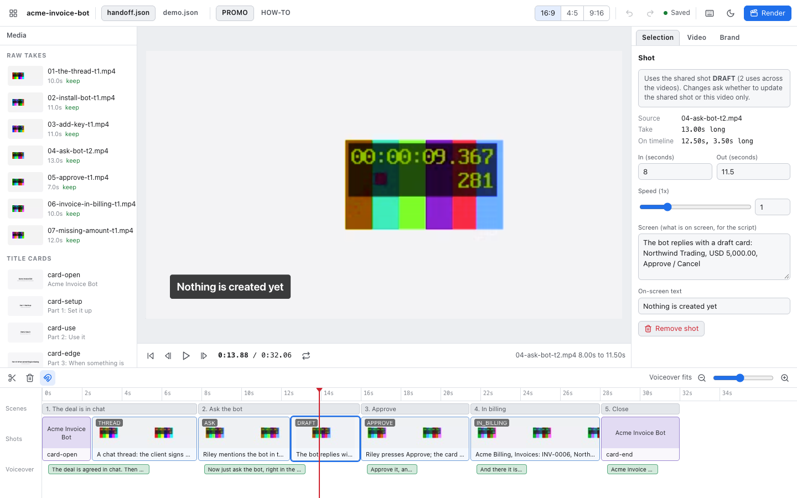

# demo-studio

[](https://github.com/Cyvid7-Darus10/demo-studio/actions/workflows/ci.yml)
[](LICENSE)

A Claude Code plugin that makes product demo videos from real screen recordings.

You give Claude a goal (or a brief someone sent you) and log in to a sandbox account. It plans the
story, tests that every step works, records the browser, cuts the videos, writes the voiceover and
packages everything for an editor. The footage is the real product running; nothing on screen is
AI-generated.

It grew out of a run of partner and product demos, and the gotchas from those shoots are written
down in [references/learnings.md](references/learnings.md).

**Contents:** [What it makes](#what-it-makes) · [Requirements](#requirements) · [Install](#install) ·
[Quickstart](#quickstart-5-minutes-to-the-first-plan) · [Starter kit](#starter-kit) ·
[Rules](#rules-and-quality-gates) · [Two ways to finish](#two-ways-to-finish) ·
[Local editor](#local-editor) · [FAQ](#faq) · [Contributing](#contributing)

## What it makes

| Deliverable | What it is |
| --- | --- |
| Plan | BRIEF, RUN-SHEET (beats and exact on-camera text), SHOT-LIST, VOICEOVER draft, PREP checklist |
| Raw takes | One clean clip per scene: 1920x1080, 30fps, H.264, crisp 2x capture, secrets blurred in the page, logged in `takes.csv` |
| Review reel | The keeper takes joined uncut in story order, for the first review |
| Keynote cut | Optional: footage in a floating rounded window, captions, title cards, eased zooms |
| Promo cut | About 1:30, the story, as numbered clips plus a rough assembly |
| How-to cut | About 3:00, the story plus setup steps and an edge case |
| Voiceover scripts | Spoken lines per scene with start times, a fit check, and a timing preview with a placeholder voice |
| Editor handoff zip | READ-ME-FIRST brief, scripts, clips, uncut source footage by story part, contact sheets, title cards, brand sheet |
| Social versions | Optional 4:5 (1080x1350) and 9:16 (1080x1920) cuts with a caption band |

## Requirements

We use **Playwright** (the Playwright MCP server and `playwright-core`), not Puppeteer.

| Need | Why | Install |
| --- | --- | --- |
| Claude Code with plugin support | Runs the skills | `npm i -g @anthropic-ai/claude-code` |
| Node.js 20+ (22 LTS recommended) | Frame receiver, recorder, title cards | `brew install node` |
| Google Chrome | The recorded browser and the title-card renderer | `brew install --cask google-chrome` or google.com/chrome |
| Playwright MCP | Claude drives and records the browser through it | See below |
| `playwright-core` | Used by `rec.mjs` (multi-window recording), `run.mjs` and `title-cards.mjs` | `npm install` in the plugin folder (below) |
| Local editor packages (optional) | The `npm run studio` editor (React, Vite, ajv); about 150 MB | The same `npm install` installs them |
| Python 3.10+ | Edit, handoff and QA scripts; standard library only, no pip | `brew install python` |
| ffmpeg with libx264 | All encoding | `brew install ffmpeg` |
| 10 GB+ free disk | Raw frames take several GB per demo | |
| macOS `say` (optional) | Voiceover fit check and timing preview; estimated from word count elsewhere | Built into macOS |
| Sandbox or test accounts | Everything filmed must be safe to show | Per product |
| Cardboard and its `cb` CLI (optional) | Lets Claude finish the video itself: narration, captions, music, export | See [Two ways to finish](#two-ways-to-finish) |

It is built and used on macOS. The scripts avoid macOS-only tools (`say` is optional) and CI runs
the pipeline on Linux, but recording on Linux or Windows has had far less use. Reports are welcome.

### Playwright MCP

Add it to Claude Code (user scope), using real Chrome:

```bash
claude mcp add playwright --scope user -- npx -y @playwright/mcp --browser chrome
```

or in your MCP config:

```json
{ "mcpServers": { "playwright": { "command": "npx", "args": ["-y", "@playwright/mcp", "--browser", "chrome"] } } }
```

Log in to the product's sandbox in the browser that the Playwright MCP opens (not your everyday
Chrome). If you use your own Playwright MCP profile, remember it is logged in as you.

## Install

1. Install the requirements above.
2. In Claude Code:

   ```
   /plugin marketplace add Cyvid7-Darus10/demo-studio
   /plugin install demo-studio@demo-studio
   ```

3. Install `playwright-core` and the local editor's packages into the plugin folder, then run the
   health check:

   ```bash
   P="$(ls -d ~/.claude/plugins/cache/demo-studio/demo-studio/*/ | tail -1)"
   npm install --prefix "$P"
   bash "$P/scripts/doctor.sh"
   ```

   `doctor.sh` checks every requirement and prints the exact fix command for anything missing.

Working on the plugin itself? Clone the repo, run `npm install` there, and start Claude Code with
`claude --plugin-dir /path/to/demo-studio`.

## Quickstart (5 minutes to the first plan)

1. Make a folder for demos and start Claude Code there: `mkdir -p ~/demos && cd ~/demos && claude`.
2. Ask:

   > Make a demo of the Acme invoice bot. Goal: a sales person turns a chat thread into an invoice
   > in one click. Audience: agency owners. I'm logged in to the sandbox in the Playwright browser.

3. Claude runs the health check, asks one round of questions (accounts, brief, videos wanted), then
   scaffolds `demos/<name>/` and shows you the scene table. Say "go" or adjust it.
4. It preps, records each scene, shows you the review reel, then builds the cuts and the handoff zip.

The skill also triggers on "record a walkthrough of...", "film a product demo...", or "hand these
takes to an editor". See `examples/acme-invoice-bot/` for a filled-in plan.

## Starter kit

A demos folder works better with a playbook and an index. One command adds them (it never
overwrites a file that is already there):

```bash
bash "$P/scripts/new-workspace.sh" ./demos
```

| File | What it is |
| --- | --- |
| `AGENTS.md` | The playbook Claude reads first: modes, how much to ask, stage gates, house rules, folder layout. Edit it to fit your team; it wins over the plugin's defaults |
| `CLAUDE.md` | Points Claude at the playbook and the session routine |
| `README.md` | The index: one row per demo with its status and final cut |
| `check.py` | A drift report: index rows that point nowhere, takes nobody reviewed, throwaways never deleted, leftover frames, stray secrets files, low disk |
| `.gitignore` | Keeps recordings, zips, browser profiles and `.env` files out of git |

Each demo then gets its own folder from `new-demo.sh` (Claude runs it): brief, run sheet, shot list,
voiceover draft, prep checklist, throwaways list, `demo.json` and `handoff.json`.
See [examples/acme-invoice-bot](examples/acme-invoice-bot) for one filled in.

## Rules and quality gates

A demo that shows something a viewer cannot repeat is worse than no demo. The plugin holds the line
on a few things, written out in [references/quality-gates.md](references/quality-gates.md):

- **Claims list.** Every claim the video makes maps to a shot that proves it, or it is cut.
- **Test sweep before any take.** Every scene and edge case run off camera from a clean state, the
  hero flow twice, and a hunt for dead ends: links, commands and setup steps a viewer could not repeat.
- **Secrets are masked in the page, never in post**, and every reveal is checked frame by frame
  ([references/secrets.md](references/secrets.md)). Sandbox or test accounts only.
- **Real actions, cleaned up.** Things are created for real on camera, listed in THROWAWAYS.md and
  deleted after sign-off. Nothing is faked.
- **Cold follow-through.** Before sending, the how-to script is followed literally on a fresh account.

## Two ways to finish

| | Built in (default) | Cardboard (optional) |
| --- | --- | --- |
| Needs | ffmpeg | The Cardboard desktop app, signed in, with its `cb` CLI installed |
| You get | Rough assemblies, scripts, voiceover timing and a zip for a human editor | A finished video with generated narration, synced captions and music |
| Skills | `demo-edit`, `demo-handoff` | `demo-cardboard`, after `demo-edit` |

Both start from the same `handoff.json`, so you can hand off to an editor and finish a version in
Cardboard from one shoot. Nothing in the plugin requires Cardboard, and `doctor.sh` only notes
whether it is there. Details: [references/cardboard.md](references/cardboard.md).

## Stages

```
 goal or brief
      |
  [plan]      demo-plan     BRIEF, RUN-SHEET, SHOT-LIST, VOICEOVER, PREP, demo.json
      |
  [prep]      demo-plan     sandbox accounts, seeded demo user, reset scripts, smoke run
      |
  [record]    demo-record   2x screencast per scene, secrets masked, contact-sheet QA, takes.csv
      |
  [review]    demo-edit     review reel of keepers, agreed with you
      |
  [edit]      demo-edit     keynote cut (demo.json) / promo + how-to (handoff.json), title cards,
      |                     voiceover fit check, timing preview
  [handoff]   demo-handoff  editor folder + zip, READ-ME-FIRST, brand sheet
      |       or demo-cardboard (optional): narration, captions, music, export
      |
  [social]    demo-edit     4:5 and 9:16 versions
      |
  [wrap-up]   demo-handoff  status, throwaways, key rotation, delete frames
```

The `demo-studio` skill orchestrates; each stage has its own skill you can also call directly.

## Repo layout

```
.claude-plugin/   plugin.json, marketplace.json
skills/           demo-studio (orchestrator), demo-plan, demo-record, demo-edit, demo-handoff,
                  demo-cardboard (optional)
scripts/          every tool (recorder, QA, encode, edit, handoff, social, scaffold, doctor)
starter/          the workspace kit new-workspace.sh installs: playbook, index, check.py
schemas/          demo.schema.json and handoff.schema.json (the config shapes the scripts check)
templates/        files new-demo.sh copies into a new demo
references/       learnings, quality gates, scene patterns, voiceover, handoff spec, secrets, cardboard
examples/         acme-invoice-bot: a small, fully filled fictional demo
app/              local editor: React UI (src/), file and render server (server/), tests (e2e/)
tests/            smoke.sh (end to end on synthetic footage) and unit tests for the Python tools
docs/             ROADMAP.md, img/ (editor screenshots)
```

## Local editor

A local web app for reviewing and tweaking a cut without rendering. Open a demo folder, watch the
edit play in real time, trim and reorder shots, edit on-screen text and voiceover, check the 4:5 and
9:16 framing, then press Render to run the same scripts Claude runs.

```bash
npm install                                   # once, in the repo (or the plugin folder)
npm run studio demos/acme                     # or: npx demo-studio demos/acme
npm run studio                                # no folder: pick from $DEMO_ROOT (default ./demos) and examples/
npm run studio demos/acme -- --port 4400 --no-open
```

It serves on `127.0.0.1` only (port 4317, or the next free one) and opens your browser. The first
run builds the UI, which takes a few seconds. To try it without footage, copy the example and make
small synthetic takes for it:

```bash
cp -R examples/acme-invoice-bot /tmp/acme && node app/scripts/example-media.mjs /tmp/acme
npm run studio /tmp/acme
```


| Light theme | 9:16 framing | Render drawer |
| --- | --- | --- |
|  |  |  |

**Layout.** Top bar: the demo, a tab per file (`handoff.json`, `demo.json`), a tab per video, the
aspect switch, undo and redo, save status and Render. Left: raw takes (with keep, alt and reject
from `takes.csv`), title cards and named shots; drag any of them onto the timeline. Center: the
preview, which plays the clips in order with their in and out points and speed, draws title cards
(the rendered PNG, or the card text in the brand colours until you render), shows on-screen text,
and frames 4:5 and 9:16 the way `social-cut.py` does. Bottom: the timeline, with scenes, shots sized
by their length after speed, and a voiceover lane that turns red when a line runs past the next
narrated scene (the same estimate as `build-handoff.py --no-say`). Right: the inspector for the
selected shot, scene, card, the video, and the brand.

**Your files stay the source of truth.** The editor reads and writes `handoff.json` and `demo.json`
directly, in the schema shape, keeping `_comment` and other `_` keys. It saves about a second after
each edit (to a temp file, then renamed over the original), checks the file against the schema
first and never writes an invalid one. If Claude or a text editor changes the file while it is
open, the editor reloads it, or asks which version to keep when you have unsaved edits. Editing a
shot that uses `{"ref": ...}` asks whether to change the shared shot (every video) or only this
video (an override on the ref).

**Render** runs `title-cards.mjs`, `build-handoff.py`, `build-keynote.py`, `review-reel.py` or
`social-cut.py` in the demo folder, one at a time, with a progress bar, the log, the output in a
player, and Reveal in Finder and Open buttons. Cancel stops the script and everything it started.
**Quick preview** (`scripts/quick-preview.py`) renders the current video at 960x540 with fast
settings, for a faithful check of speed changes and cards; the live preview stays the default.

| Keys | Action |
| --- | --- |
| Space, K, L | Play or pause, pause, play |
| J, Shift+Left, Shift+Right | Back 1 second, back 1 second, forward 1 second |
| Left, Right | One frame back or forward |
| Home, End | Start, end |
| O | Loop the selected shot |
| S | Split the shot at the playhead |
| Delete | Remove the selected shot |
| Cmd+Z, Cmd+Shift+Z | Undo, redo |
| =, - | Zoom the timeline |
| 1, 2, 3 | 16:9, 4:5, 9:16 |
| ? | Show the shortcuts |

Limits: the preview has no audio (raw takes have none) and does not draw the keynote cut's zooms
or dissolves; use Quick preview or the real render for those. It is tested in Chrome, and it is
for the same machine only, never exposed on a network.

## FAQ

**Where do files go?**
Each demo lives in `$DEMO_ROOT/<name>/` (default `./demos/<name>/` under the folder you started
Claude in). Raw takes in `recordings/raw/`, cuts in `recordings/exports/`, the editor folder in
`recordings/editor-handoff/` and the zip next to it. Nothing is written into the plugin folder.

**How long does it take?**
Planning 15 to 30 minutes. Recording about 5 to 10 minutes per scene including QA, so a 10-scene demo
is an afternoon. Rendering is about one second of CPU per second of output for the keynote cut, and
a few minutes for the full handoff.

**How much disk space?**
Have 10 GB free. A 60-second take is 0.5 to 1 GB of frames until it is approved; the encoded clips are
small. Delete `recordings/frames/` after sign-off (Claude asks first).

**How do I re-shoot one scene?**
Ask: "re-shoot scene 04, the bot reply was slow". Claude records a new take (`04-...-t2.mp4`), marks
it `keep` in `takes.csv`, and you rebuild with the same commands. If the scene shows seeded data that
changed, re-shoot every scene that depends on it (the shot list's "Depends on" column).

**How do I change branding?**
Edit `brand` and `cards` in the demo's `handoff.json` (colours, font, logo, taglines), then
`node "$P/scripts/title-cards.mjs" handoff.json` and rebuild. The keynote look's colours and type are
in `scripts/mk-assets.py` and `scripts/build-keynote.py`.

**How do I add voiceover?**
Put a `voiceover` line on each scene in `handoff.json` (spoken English, about 2.5 words per second, no
symbols). `build-handoff.py` checks each line fits and writes the voiceover file with start times for
an AI voice tool. On macOS it also renders a timing preview with a placeholder voice.

**Can I record two people at once (an admin and a member)?**
Yes. `scripts/open-window.sh` opens a Chrome window per person with its own profile; list them in
`demo.json` `windows` and Claude records each with `scripts/rec.mjs`.

**Is it safe to film?**
Only with sandbox or test accounts. Secrets are blurred in the page as they render and every reveal
is checked frame by frame. See `references/secrets.md`.

## Tests

```bash
npm install && bash tests/smoke.sh   # pipeline, on synthetic footage
python3 -I tests/test_check.py && python3 -I tests/test_cardboard_timeline.py   # Python unit tests
npm run test:app                     # editor unit tests (vitest)
npm run test:e2e                     # editor end to end, headless Chrome on a temp copy of the example
npm run screenshots -w app           # refresh docs/img/
```

## Contributing

Every demo teaches something, and the most useful contribution is often one line in
[references/learnings.md](references/learnings.md). See [CONTRIBUTING.md](CONTRIBUTING.md) for
setup, where things go and how to test. Security reports: [SECURITY.md](SECURITY.md).
What is planned: [docs/ROADMAP.md](docs/ROADMAP.md).

## License

Apache License 2.0. If you use or adapt this code, keep the [NOTICE](NOTICE) file, which credits
Cyrus David Pastelero, as the license requires. See [LICENSE](LICENSE).
