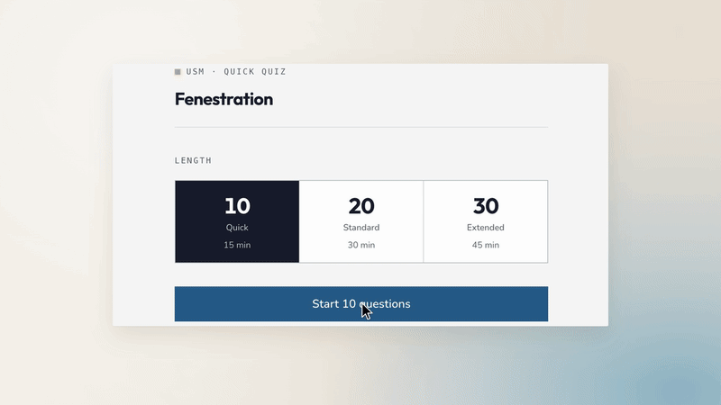
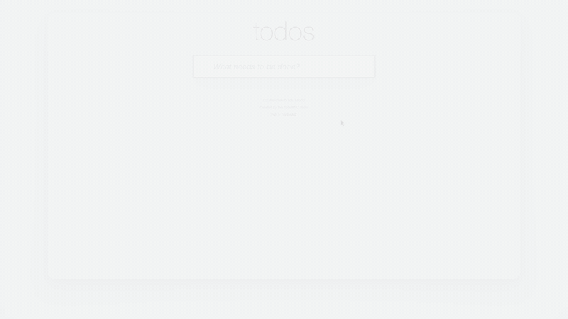
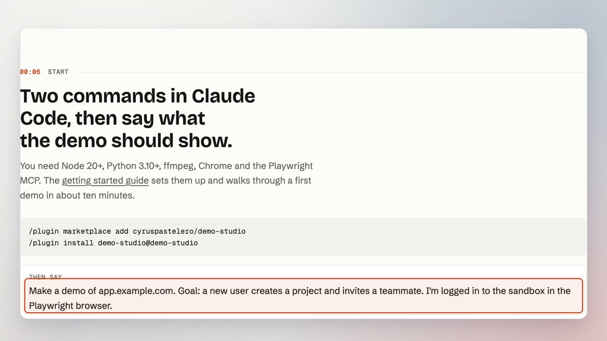

<p align="center">
  
</p>

<h1 align="center">demo-studio</h1>

<p align="center">
  <b>Tell Claude the goal. Get a finished demo video of your real app.</b>
</p>

<p align="center">
  <a href="https://github.com/cyruspastelero/demo-studio/actions/workflows/ci.yml"></a>
  <a href="LICENSE"></a>
  
</p>

<p align="center">
  <a href="https://cyruspastelero.github.io/demo-studio/"><b>Live demo</b></a>
  &nbsp;·&nbsp;
  <a href="#install"><b>Install</b></a>
  &nbsp;·&nbsp;
  <a href="#use-it-in-claude-code"><b>Use it</b></a>
  &nbsp;·&nbsp;
  <a href="#docs"><b>Docs</b></a>
</p>

demo-studio is a Claude Code plugin. You give Claude a goal and a sandbox login. Claude plans the
story, records your real product in a browser, cuts and narrates the video, and can package it for
an editor. It only stops to ask for a 2FA code, or before a step that costs money or can't be undone.

- **Real footage.** Every frame is your product running. Nothing on screen is AI-generated.
- **Local and free.** It runs on your machine with free tools (Playwright, Chrome, ffmpeg, Python,
  Node). There's no account and no telemetry. Narration uses macOS `say` for free. ElevenLabs and
  Higgsfield are optional.
- **Safe.** It uses sandbox accounts only and masks secrets in the page before any frame is captured.
  Credentials stay in your Keychain and never go in a file. See [SECURITY.md](SECURITY.md).
- **Polished by default.** Every cut is checked against a [measured quality bar](docs/quality-bar.md):
  floating window, zooms, highlights, callouts, titles, end card, mixed to -14 LUFS.

## Samples

Every sample below was recorded from a real app and finished by the plugin. Click a preview to watch
the 1080p video with sound.

| Study app showcase (1:18) | Todo app sample (0:37) |
| --- | --- |
| [](https://github.com/cyruspastelero/demo-studio/releases/download/samples/sample-showcase.mp4) | [](https://github.com/cyruspastelero/demo-studio/releases/download/samples/sample-todo.mp4) |
| A live web app with a seeded demo learner. | [TodoMVC](https://todomvc.com), a public todo app, no login. Rebuild it from [examples/todo-sample](examples/todo-sample). |
| **Launch ad, `airy` (0:36)** | **Narrated walkthrough (1:10)** |
| [](https://github.com/cyruspastelero/demo-studio/releases/download/samples/sample-launch-ad.mp4) | [](https://github.com/cyruspastelero/demo-studio/releases/download/samples/sample-launch.mp4) |
| A beat-synced motion ad. Storyboard: [examples/launch-ad](examples/launch-ad). | A keynote cut with narration. Plan: [examples/demo-studio-launch](examples/demo-studio-launch). |
| **Switchyard launch ad, `daylight` (0:36)** | |
| [](https://github.com/cyruspastelero/demo-studio/releases/download/samples/sample-daylight-ad.mp4) | |
| An ad for the open-source [Switchyard](https://github.com/cyruspastelero/switchyard) app. Storyboard: [examples/switchyard-launch](examples/switchyard-launch). | |

## Install

You need Claude Code, macOS (Linux works but has had less testing), and about 10 GB of free disk.

**1. Install the tools and the Playwright MCP** (one time):

```bash
brew install node ffmpeg python && brew install --cask google-chrome
claude mcp add playwright --scope user -- npx -y @playwright/mcp@0.0.84 --browser chrome
```

**2. Add demo-studio.** Pick one of these.

<details open>
<summary><b>As a plugin</b>, to use it in any folder</summary>

In Claude Code:

```
/plugin marketplace add cyruspastelero/demo-studio
/plugin install demo-studio@demo-studio
```

Then in a terminal, install its packages and check your setup:

```bash
P="$(ls -d ~/.claude/plugins/cache/demo-studio/demo-studio/*/ | tail -1)"
npm install --prefix "$P" && bash "$P/scripts/doctor.sh"
mkdir -p ~/demos && cd ~/demos && bash "$P/scripts/new-workspace.sh" . && claude
```

</details>

<details>
<summary><b>As a clone</b>, to read or change the code</summary>

```bash
git clone https://github.com/cyruspastelero/demo-studio.git && cd demo-studio
npm install && bash scripts/doctor.sh && bash scripts/new-workspace.sh ./demos
claude
```

Your demos go in `demos/`, which git ignores.

</details>

`doctor.sh` prints the exact fix for anything that's missing. For other systems, see
[Getting started](docs/getting-started.md).

## Use it in Claude Code

Just say what you want. Don't know where to start? Say **"try it"** and Claude records the
[todo sample](examples/todo-sample) from start to finish, with no login
([10-minute walkthrough](docs/getting-started.md#first-demo-in-10-minutes)).

**Make a demo of your app.** Log in to your sandbox in the browser that Playwright opens, then say:

> Make a demo of app.example.com. Goal: a new user creates a project and invites a teammate.
> I'm logged in to the sandbox in the Playwright browser.

Or let Claude log in by itself, off camera. Save the password in Keychain first
(`security add-generic-password -s demo-acme -a demo@example.com -w`), then say:

> The sandbox login is demo@example.com, and the password is in Keychain as demo-acme.

**More things to ask for:**

| Say | Skill it runs |
| --- | --- |
| "Make a demo of X", "try it" | `demo-studio`: the whole thing, end to end |
| "Plan a demo from this brief", "stop after the plan" | `demo-plan` |
| "Re-shoot scene 2" | `demo-record` |
| "Record the Notes app", "film this desktop app" | `demo-record` with `deskcap`, for apps outside the browser ([desktop apps](docs/desktop.md), macOS) |
| "Make a promo cut", "add music", "make a 9:16 version" | `demo-edit` |
| "Make a launch ad" | `demo-motion`: beat-synced ad (`airy`, `daylight`, `nocturne`, `showroom`) |
| "Copy the look of launch.mp4", "use template house" | `demo-template` |
| "Package it for the editor" | `demo-handoff`: a zip with clips, scripts, voiceover and brief |
| "Organise my demos" | `demo-organize` |

You can also call a skill by name: `/demo-studio:demo-motion` as a plugin, or `/demo-motion` in a clone.

## What you get

When it's done, you get one report with:

- a written plan and a clean 1080p take for each scene
- a review reel, a keynote-style cut and a narrated version
- if you ask: promo and how-to cuts, 4:5 and 9:16 social versions, and an editor handoff zip

To tweak a cut yourself, run `npm run studio` (or `npm --prefix "$P" run studio` for the plugin).
It opens a local timeline editor where you can scrub, retime shots, and rewrite voiceover lines,
and it tells you right away if a line no longer fits.
[Try the editor in your browser](https://cyruspastelero.github.io/demo-studio/#editor).

<p align="center">
  
</p>

## Voice and music

| Voice | Cost |
| --- | --- |
| macOS `say` (default) | Free |
| Your own recordings in `voiceover/` | Free |
| ElevenLabs (API key or MCP) | Your plan. Lines are cached, so re-runs are free |
| Higgsfield (MCP) | Your credits |

Before any voice is made, each line is checked to make sure it fits its slot. Music can be your own
licensed track, or one made with ElevenLabs or Higgsfield. See [How it works](docs/how-it-works.md).

## Docs

| Page | What's in it |
| --- | --- |
| [Getting started](docs/getting-started.md) | Requirements, install, first demo, the demos-folder starter kit |
| [How it works](docs/how-it-works.md) | Stages, deliverables, quality gates, narration and music |
| [Desktop apps](docs/desktop.md) | Recording native macOS apps outside the browser with `deskcap` |
| [Studio](docs/studio.md) | The local dashboard and editor |
| [Quality bar](docs/quality-bar.md) | The minimum every finished cut must pass |
| [Look templates](docs/templates.md) | Built-in looks, copying a video's look, sharing templates |
| [Launch ads](docs/motion.md) | Storyboards, motion templates, rendering |
| [Style guide](references/style-guide.md) | Pointer, typing, pacing, zooms, callouts, voice |
| [Samples](samples/README.md) | Scene recipes and a full sample plan |
| [FAQ](docs/faq.md) | Passwords, cost, what stays local, re-shoots, branding |
| [Dependencies](docs/dependencies.md) | Every tool, package and font, with versions and licences |
| [Development](docs/development.md) | Repo layout and tests (`claude --plugin-dir .` to work on the plugin) |

## Contributing

Often the most useful thing you can add is one line in [references/learnings.md](references/learnings.md).
See [CONTRIBUTING.md](CONTRIBUTING.md) and the [roadmap](docs/ROADMAP.md). Report security issues
through [SECURITY.md](SECURITY.md).

## License

Apache License 2.0. If you use or adapt this code, keep the [NOTICE](NOTICE) file, which credits
Cyrus David Pastelero. See [LICENSE](LICENSE).
