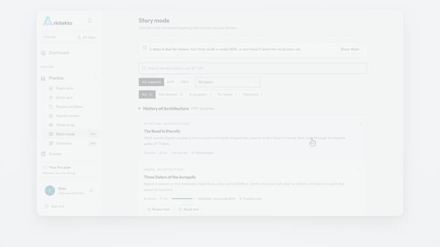

# demo-studio

[](https://github.com/Cyvid7-Darus10/demo-studio/actions/workflows/ci.yml)
[](LICENSE)

A Claude Code plugin that turns a goal into a finished product demo video, recorded from the real
product with Playwright. Claude plans the story, records the browser, cuts the video, narrates it
and packages a handoff for an editor.

- **Real footage.** Every frame is your product running. Nothing on screen is AI-generated.
- **Free and local.** Playwright, ffmpeg and a built-in editor on your machine. Narrate with macOS
  `say` or your own voice. ElevenLabs is optional.
- **Safe to film.** Sandbox accounts only, and secrets are masked in the page before a frame is captured.
- **Looks professional by default.** Crisp 2x capture, a human-paced cursor, eased zooms, captions and title cards.

## Sample videos

Both were recorded from the real app and cut with the plugin's scripts. Click a preview for the full 1080p video.

| Story mode in a study app (37s) | Todo app sample (27s) |
| --- | --- |
| [](https://github.com/Cyvid7-Darus10/demo-studio/releases/download/v0.2.0/sample-story-mode.mp4) | [](https://github.com/Cyvid7-Darus10/demo-studio/releases/download/v0.2.0/sample-todo.mp4) |
| A live web app with a seeded demo learner: search, a highlighted story, a quick check. Pointing-hand cursor, zooms, captions, end card. | A public todo app ([TodoMVC](https://todomvc.com)), three scenes, no login. Its plan, scene scripts and configs are in [examples/todo-sample](examples/todo-sample), so you can record it yourself. |

## Quick start

```
/plugin marketplace add Cyvid7-Darus10/demo-studio
/plugin install demo-studio@demo-studio
```

Then set up once (macOS with Homebrew; [other systems](docs/getting-started.md#requirements)):

```bash
brew install node ffmpeg python && brew install --cask google-chrome
claude mcp add playwright --scope user -- npx -y @playwright/mcp --browser chrome
P="$(ls -d ~/.claude/plugins/cache/demo-studio/demo-studio/*/ | tail -1)"
npm install --prefix "$P" && bash "$P/scripts/doctor.sh"
```

Start Claude Code in a folder for your demos and ask:

> Make a demo of app.example.com. Goal: a new user creates a project and invites a teammate.
> I'm logged in to the sandbox in the Playwright browser.

New here? Say **"try it"** and Claude records the [todo sample](examples/todo-sample) end to end,
no login needed ([10 minute walkthrough](docs/getting-started.md#first-demo-in-10-minutes)).

## What you get

A plan to approve, a clean 1080p take per scene, a review reel, a keynote-style cut with captions
and zooms, a narrated version, promo and how-to cuts, 4:5 and 9:16 social versions, and a zip for a
human editor. Ask for as much or as little as you need.

## Docs

| Page | What is in it |
| --- | --- |
| [Getting started](docs/getting-started.md) | Requirements, install, the first demo, the starter kit for a demos folder |
| [How it works](docs/how-it-works.md) | Stages, deliverables, quality gates, narration and music |
| [Studio](docs/studio.md) | The local dashboard and the editor |
| [Style guide](references/style-guide.md) | The house look: pointer, typing, pacing, zooms, captions, voice |
| [Samples](samples/README.md) | Scene recipes and a full sample plan to copy from |
| [FAQ](docs/faq.md) | Files, timing, disk space, re-shoots, branding, safety |
| [Development](docs/development.md) | Repo layout and tests |

## Contributing

The most useful contribution is often one line in [references/learnings.md](references/learnings.md).
See [CONTRIBUTING.md](CONTRIBUTING.md). Security reports: [SECURITY.md](SECURITY.md).
Plans: [docs/ROADMAP.md](docs/ROADMAP.md).

## License

Apache License 2.0. If you use or adapt this code, keep the [NOTICE](NOTICE) file, which credits
Cyrus David Pastelero. See [LICENSE](LICENSE).
