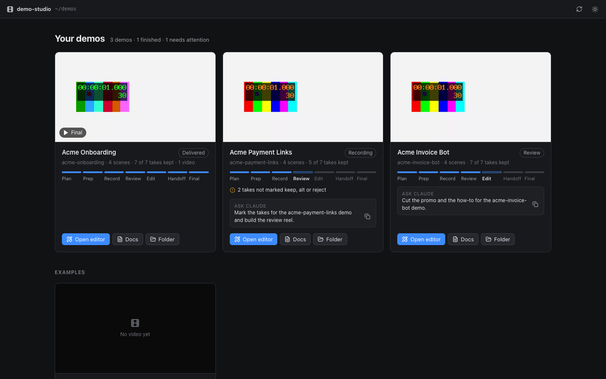
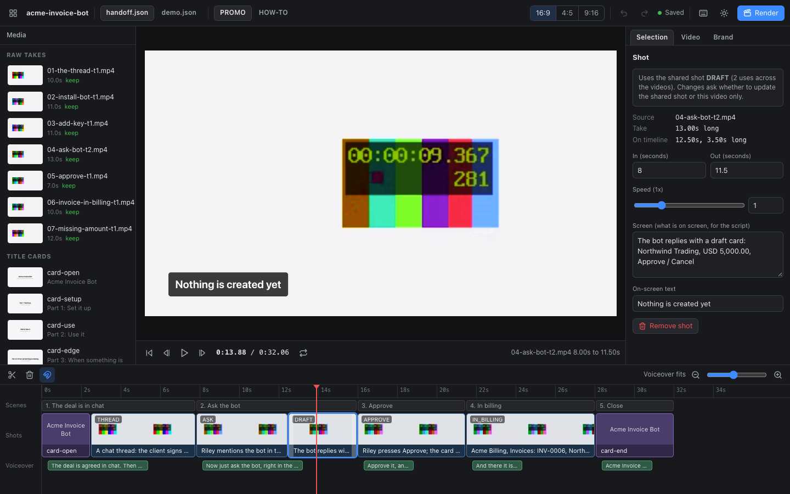
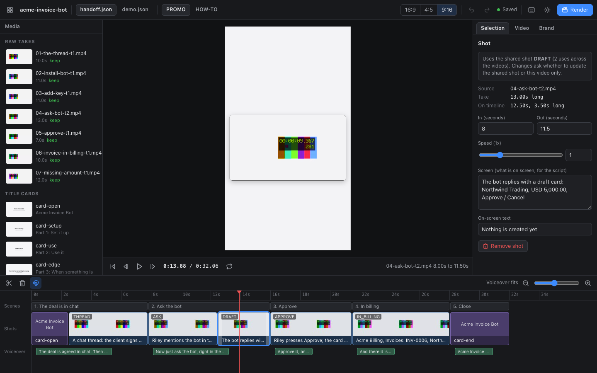
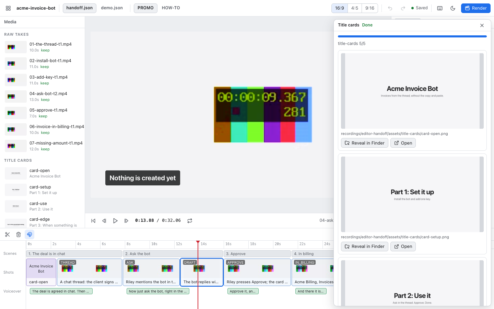

# demo-studio

[](https://github.com/Cyvid7-Darus10/demo-studio/actions/workflows/ci.yml)
[](LICENSE)

A Claude Code plugin that turns a goal into a finished product demo video, recorded from the real
product with Playwright.

You give Claude a goal (or a brief someone sent you) and log in to a sandbox account. It plans the
story, tests that every step works, records the browser, cuts the video, writes and records the
voiceover, and packages everything for an editor. The footage is the real product running; nothing
on screen is AI-generated.

**Everything runs locally and free:** Playwright, ffmpeg, the built-in editor, and macOS `say` or
your own voice for narration. ElevenLabs is optional.

## Sample videos

Both were recorded from the real app and cut with the plugin's scripts. Click a preview for the full 1080p video.

| Story mode in a study app (37s) | Todo app sample (27s) |
| --- | --- |
| [](https://github.com/Cyvid7-Darus10/demo-studio/releases/download/v0.2.0/sample-story-mode.mp4) | [](https://github.com/Cyvid7-Darus10/demo-studio/releases/download/v0.2.0/sample-todo.mp4) |
| A live web app with a seeded demo learner: search, a highlighted story, a quick check. Pointing-hand cursor, zooms, captions, end card. | A public todo app ([TodoMVC](https://todomvc.com)), three scenes, no login. Its plan, scene scripts and configs are in [examples/todo-sample](examples/todo-sample), so you can record it yourself. |

## Start here

You need macOS (Linux works with less testing), Claude Code, and a sandbox account for the product
you want to film.

**1. Install the plugin** in Claude Code:

```
/plugin marketplace add Cyvid7-Darus10/demo-studio
/plugin install demo-studio@demo-studio
```

**2. Set up once** in a terminal (Homebrew shown; see [Requirements](#requirements) for others):

```bash
brew install node ffmpeg python && brew install --cask google-chrome
claude mcp add playwright --scope user -- npx -y @playwright/mcp --browser chrome
P="$(ls -d ~/.claude/plugins/cache/demo-studio/demo-studio/*/ | tail -1)"
npm install --prefix "$P" && bash "$P/scripts/doctor.sh"
```

`doctor.sh` checks everything and prints the exact fix for anything missing.

**3. Ask Claude.** Start Claude Code in a folder for your demos (`mkdir -p ~/demos && cd ~/demos && claude`)
and say what you want:

> Make a demo of app.example.com. Goal: a new user creates a project and invites a teammate.
> Audience: small team leads. I'm logged in to the sandbox in the Playwright browser.

**What you get:** a written plan to approve, a clean 1080p take per scene, a review reel, a
keynote-style cut with captions and zooms, a narrated version, promo and how-to cuts, 4:5 and 9:16
social versions, and a zip for a human editor. Ask for as much or as little as you need.
Want to see it work first? Do the [first demo in 10 minutes](#first-demo-in-10-minutes).

## First demo in 10 minutes

No account or login needed. This records and cuts [examples/todo-sample](examples/todo-sample), a
public todo app, so you see the whole pipeline once. After the setup above, start Claude Code in an
empty folder and say:

> Try demo-studio on the todo sample.

Claude then:

1. Copies the sample into `demos/todo-sample/` (its plan and three scene scripts are already written).
2. Starts the recorder and opens the todo app in the Playwright browser at 2x.
3. Records the three scenes, checks each one on a contact sheet, and encodes the takes.
4. Shows you the review reel, then builds the keynote cut with captions, cards and zooms.
5. Narrates it with macOS `say` (or your own voice or ElevenLabs, if set up) and opens
   `demos/todo-sample/recordings/exports/todo-app-sample-keynote-cut-narrated.mp4`.

To do the same steps by hand, follow the commands in [examples/todo-sample/README.md](examples/todo-sample/README.md).

**Contents:** [First demo](#first-demo-in-10-minutes) · [What it makes](#what-it-makes) · [How it works](#how-it-works) ·
[What makes a demo look good](#what-makes-a-demo-look-good) · [Samples](#samples-and-examples) ·
[Requirements](#requirements) · [Starter kit](#starter-kit) · [Quality gates](#rules-and-quality-gates) ·
[Finishing](#finishing-the-video) · [Home screen](#home-screen) · [Local editor](#local-editor) ·
[FAQ](#faq) · [Optional extras](#optional-extras) · [Repo layout](#repo-layout) · [Contributing](#contributing)

## What it makes

| Deliverable | What it is |
| --- | --- |
| Plan | BRIEF, RUN-SHEET (beats and exact on-camera text), SHOT-LIST, VOICEOVER draft, PREP checklist |
| Raw takes | One clean clip per scene: 1920x1080, 30fps, H.264, crisp 2x capture, secrets blurred in the page, logged in `takes.csv` |
| Review reel | The keeper takes joined uncut in story order, for the first review |
| Keynote cut | Footage in a floating rounded window, captions, title cards, eased zooms |
| Narrated cut | The keynote cut with the voiceover recorded and placed, optional music bed, loudness-normalised |
| Promo cut | About 1:30, the story, as numbered clips plus a rough assembly |
| How-to cut | About 3:00, the story plus setup steps and an edge case |
| Voiceover scripts | Spoken lines per scene with start times, a fit check, and a timing preview |
| Editor handoff zip | READ-ME-FIRST brief, scripts, clips, uncut source footage by story part, contact sheets, title cards, brand sheet |
| Social versions | 4:5 (1080x1350) and 9:16 (1080x1920) cuts with a caption band |

## How it works

```
 goal or brief
      |
  [plan]      demo-plan     BRIEF, RUN-SHEET, SHOT-LIST, VOICEOVER, PREP, demo.json
  [prep]      demo-plan     sandbox accounts, seeded demo user, reset scripts, test sweep
  [record]    demo-record   2x screencast per scene, secrets masked, contact-sheet QA, takes.csv
  [review]    demo-edit     review reel of keepers, agreed with you
  [edit]      demo-edit     keynote cut, narration, promo + how-to, title cards, voiceover fit check
  [handoff]   demo-handoff  editor folder + zip, READ-ME-FIRST, brand sheet
  [social]    demo-edit     4:5 and 9:16 versions
  [wrap-up]   demo-handoff  status, throwaways, key rotation, delete frames
```

The `demo-studio` skill runs the stages in order; each stage has its own skill you can also call
directly. The skill also triggers on "record a walkthrough of...", "film a product demo..." or
"hand these takes to an editor".

## What makes a demo look good

The house look, in short. The full guide an agent follows is
[references/style-guide.md](references/style-guide.md).

- **Crisp capture.** A 1440x810 viewport at 2x pixel density, downscaled to 1080p, so UI text reads.
- **A clean frame.** No banners, toasts, cookie bars or personal history. One consistent, seeded world.
- **A calm pointer.** The normal arrow, gliding on an eased arc, a short pause before each click,
  then parked out of the way. Never a teleport, never a click dot.
- **Human typing.** 45 to 75ms a key for short text; long text is pasted.
- **Room to breathe.** A still second at the start of every take, a hold at the end, and about two
  seconds on every result. Waits are trimmed in the edit, not hidden.
- **Restrained zooms.** 1.5 to 1.75x, eased, on the hero moment only.
- **Short captions.** One plain sentence per scene, sentence case, with a period.
- **A voice like a colleague.** Second person, present tense, about 2.5 words a second, numbers and
  URLs spelled out, music quiet under it.

## Samples and examples

| Where | What it is |
| --- | --- |
| [samples/](samples) | Scene recipes to copy (form with an error, dashboard tour, masked secret, AI reply, dialog, settings toggle, table search, two people) and a full sample plan for a fictional analytics product |
| [examples/todo-sample](examples/todo-sample) | The GIF above: a real demo recorded and cut with the plugin, with its scene scripts and configs |
| [examples/acme-invoice-bot](examples/acme-invoice-bot) | A filled-in plan for a fictional chat bot, with a client brief and two windows |

## Requirements

We use **Playwright** (the Playwright MCP server and `playwright-core`), not Puppeteer.

| Need | Why | Install |
| --- | --- | --- |
| Claude Code with plugin support | Runs the skills | `npm i -g @anthropic-ai/claude-code` |
| Node.js 20+ (22 LTS recommended) | Frame receiver, recorder, title cards | `brew install node` |
| Google Chrome | The recorded browser and the title-card renderer | `brew install --cask google-chrome` |
| Playwright MCP | Claude drives and records the browser through it | See below |
| `playwright-core` | Used by `rec.mjs` (multi-window recording), `run.mjs` and `title-cards.mjs` | `npm install --prefix "$P"` |
| Local editor packages (optional) | The `npm run studio` editor (React, Vite, ajv); about 150 MB | The same `npm install` |
| Python 3.10+ | Edit, narration, handoff and QA scripts; standard library only, no pip | `brew install python` |
| ffmpeg with libx264 | All encoding and the audio mix | `brew install ffmpeg` |
| 10 GB+ free disk | Raw frames take several GB per demo | |
| macOS `say` (optional) | Free narration, the voiceover fit check and timing preview | Built into macOS |
| Sandbox or test accounts | Everything filmed must be safe to show | Per product |

It is built and used on macOS. The scripts avoid macOS-only tools (`say` is optional) and CI runs
the pipeline on Linux, but recording on Linux or Windows has had far less use. Reports are welcome.

**Playwright MCP.** Add it to Claude Code (user scope), using real Chrome:

```bash
claude mcp add playwright --scope user -- npx -y @playwright/mcp --browser chrome
```

or in your MCP config:

```json
{ "mcpServers": { "playwright": { "command": "npx", "args": ["-y", "@playwright/mcp", "--browser", "chrome"] } } }
```

Log in to the product's sandbox in the browser that the Playwright MCP opens (not your everyday
Chrome). If you use your own Playwright MCP profile, remember it is logged in as you.

Working on the plugin itself? Clone the repo, run `npm install` there, and start Claude Code with
`claude --plugin-dir /path/to/demo-studio`.

## Starter kit

A demos folder works better with a playbook and an index. One command adds them (it never
overwrites a file that is already there):

```bash
bash "$P/scripts/new-workspace.sh" ./demos
```

| File | What it is |
| --- | --- |
| `AGENTS.md` | The playbook Claude reads first: modes, how much to ask, stage gates, house rules, folder layout. Edit it to fit your team; it wins over the plugin's defaults |
| `CLAUDE.md` | Points Claude at the playbook and the session routine |
| `README.md` | The index: one row per demo with its status and final cut |
| `check.py` | A drift report: index rows that point nowhere, takes nobody reviewed, throwaways never deleted, leftover frames, stray secrets files, low disk |
| `.gitignore` | Keeps recordings, zips, voice caches, browser profiles and `.env` files out of git |

Each demo then gets its own folder from `new-demo.sh` (Claude runs it): brief, run sheet, shot list,
voiceover draft, prep checklist, throwaways list, `demo.json` and `handoff.json`.

## Rules and quality gates

A demo that shows something a viewer cannot repeat is worse than no demo. The plugin holds the line
on a few things, written out in [references/quality-gates.md](references/quality-gates.md):

- **Claims list.** Every claim the video makes maps to a shot that proves it, or it is cut.
- **Test sweep before any take.** Every scene and edge case run off camera from a clean state, the
  hero flow twice, and a hunt for dead ends: links, commands and setup steps a viewer could not repeat.
- **Secrets are masked in the page, never in post**, and every reveal is checked frame by frame
  ([references/secrets.md](references/secrets.md)). Sandbox or test accounts only.
- **Real actions, cleaned up.** Things are created for real on camera, listed in THROWAWAYS.md and
  deleted after sign-off. Nothing is faked.
- **Cold follow-through.** Before sending, the how-to script is followed literally on a fresh account.

## Finishing the video

The free path finishes a video on your machine:

```bash
python3 -I "$P/scripts/build-keynote.py" demo.json      # the cut: window, captions, cards, zooms
python3 -I "$P/scripts/narrate.py" demo.json            # adds the voiceover (and optional music)
```

`narrate.py` reads the `voiceover` lines in `demo.json`, renders each one, places it at its item's
start, checks every line fits before the next one, ducks an optional music bed under the speech,
normalises loudness, and writes a `-narrated.mp4` next to the cut in `recordings/exports/`.
`--dry-run` checks the timing without rendering. Pick the voice with `--voice`:

| Voice | Cost | How |
| --- | --- | --- |
| `say` | Free | macOS built-in voice |
| `files` | Free | Your own recordings: `voiceover/01.wav`, `02.wav`... one per line |
| `elevenlabs` | Your ElevenLabs plan | `export ELEVENLABS_API_KEY=...` in your shell. The key is read from the environment only, never stored in a file. Lines are cached in `recordings/voice-cache/`, so re-runs cost nothing |

Optional settings go in a `voice` object in `demo.json`, for example
`{"provider": "elevenlabs", "elevenlabs": {"voice_id": "..."}, "music": "assets/bed.mp3", "music_volume": 0.12}`.

For a human editor, `build-handoff.py handoff.json` builds the promo and how-to as numbered clips
and rough assemblies, the voiceover scripts with start times, and the handoff zip.

## Home screen

A local page that shows every demo in your folder and where each one stands. Run it from the folder
you start Claude Code in (or from inside the demos folder):

```bash
npm --prefix "$P" run studio        # opens http://127.0.0.1:4317
```



Each card shows the demo's picture, its status from the index, the stages with the next one
outlined, anything that needs attention (takes nobody reviewed, throwaways not cleaned up, frames
left on disk), and the sentence to give Claude for the next step, with a copy button. From a card
you can open the editor, play a video, open the planning documents or show the folder. With no
demos yet, it shows the four steps to make the first one. It only reads your files, and it runs on
your machine only (`127.0.0.1`).

## Local editor

A local web app for reviewing and tweaking a cut without rendering. Open a demo folder, watch the
edit play in real time, trim and reorder shots, edit on-screen text and voiceover, check the 4:5 and
9:16 framing, then press Render to run the same scripts Claude runs.

```bash
npm run studio demos/acme                     # or: npx demo-studio demos/acme
npm run studio                                # no folder: the home screen, for $DEMO_ROOT (default ./demos) and examples/
npm run studio demos/acme -- --port 4400 --no-open
```

It serves on `127.0.0.1` only (port 4317, or the next free one). The first run builds the UI, which
takes a few seconds. To try it without footage, copy the example and make small synthetic takes:

```bash
cp -R examples/acme-invoice-bot /tmp/acme && node app/scripts/example-media.mjs /tmp/acme
npm run studio /tmp/acme
```



| Light theme | 9:16 framing | Render drawer |
| --- | --- | --- |
|  |  |  |

**Layout.** Top bar: the demo, a tab per file (`handoff.json`, `demo.json`), a tab per video, the
aspect switch, undo and redo, save status and Render. Left: raw takes (with keep, alt and reject
from `takes.csv`), title cards and named shots; drag them onto the timeline. Center: the preview,
which plays the clips with their in and out points and speed, draws title cards and on-screen text,
and frames 4:5 and 9:16 the way `social-cut.py` does. Bottom: the timeline, with a voiceover lane
that turns red when a line runs past the next narrated scene. Right: the inspector.

**Your files stay the source of truth.** The editor reads and writes `handoff.json` and `demo.json`
in the schema shape, keeping `_comment` and other `_` keys. It saves about a second after each edit
(to a temp file, then renamed), checks the file against the schema first and never writes an
invalid one. If Claude changes the file while it is open, the editor reloads it, or asks which
version to keep when you have unsaved edits. Editing a shot that uses `{"ref": ...}` asks whether
to change the shared shot (every video) or only this video.

**Render** runs `title-cards.mjs`, `build-handoff.py`, `build-keynote.py`, `review-reel.py` or
`social-cut.py`, one at a time, with a progress bar, the log, the output in a player, and Reveal in
Finder and Open buttons. Cancel stops the script and everything it started. **Quick preview**
renders the current video at 960x540 with fast settings, for a faithful check of speed changes and cards.

| Keys | Action |
| --- | --- |
| Space, K, L | Play or pause, pause, play |
| J, Shift+Left, Shift+Right | Back 1 second, back 1 second, forward 1 second |
| Left, Right | One frame back or forward |
| Home, End | Start, end |
| O, S, Delete | Loop the selected shot, split at the playhead, remove the shot |
| Cmd+Z, Cmd+Shift+Z | Undo, redo |
| =, - | Zoom the timeline |
| 1, 2, 3 | 16:9, 4:5, 9:16 |
| ? | Show the shortcuts |

Limits: the preview has no audio and does not draw the keynote cut's zooms or dissolves; use Quick
preview or the real render for those. It is tested in Chrome, for the same machine only.

## FAQ

**Where do files go?** Each demo lives in `$DEMO_ROOT/<name>/` (default `./demos/<name>/` under the
folder you started Claude in). Raw takes in `recordings/raw/`, cuts in `recordings/exports/`, the
editor folder in `recordings/editor-handoff/` and the zip next to it. Nothing is written into the
plugin folder.

**How long does it take?** Planning 15 to 30 minutes. Recording about 5 to 10 minutes per scene
including QA, so a 10-scene demo is an afternoon. The keynote cut renders in about one second of CPU
per second of output; the full handoff takes a few minutes.

**How much disk space?** Have 10 GB free. A 60-second take is 0.5 to 1 GB of frames until it is
approved; the encoded clips are small. Delete `recordings/frames/` after sign-off (Claude asks first).

**How do I re-shoot one scene?** Ask: "re-shoot scene 04, the bot reply was slow". Claude records a
new take (`04-...-t2.mp4`), marks it `keep` in `takes.csv`, and you rebuild. If the scene shows
seeded data that changed, re-shoot every scene that depends on it (the shot list's "Depends on" column).

**How do I change branding?** Edit `brand` and `cards` in the demo's `handoff.json` (colours, font,
logo, taglines), then `node "$P/scripts/title-cards.mjs" handoff.json` and rebuild. The keynote
look's colours and type are in `scripts/mk-assets.py` and `scripts/build-keynote.py`.

**How do I add voiceover?** Put a `voiceover` line on the items in `demo.json` (or on each scene in
`handoff.json`): spoken English, about 2.5 words per second, no symbols. `narrate.py` records and
places them on the keynote cut; `build-handoff.py` checks each line fits and writes the script with
start times for an editor. Rules: [references/voiceover.md](references/voiceover.md).

**Can I record two people at once (an admin and a member)?** Yes. `scripts/open-window.sh` opens a
Chrome window per person with its own profile; list them in `demo.json` `windows` and Claude records
each with `scripts/rec.mjs`.

**Is it safe to film?** Only with sandbox or test accounts. Secrets are blurred in the page as they
render and every reveal is checked frame by frame. See [references/secrets.md](references/secrets.md).

## Optional extras

- **ElevenLabs** for a more natural narration voice: set `ELEVENLABS_API_KEY` in your shell and
  `narrate.py` uses it. Uses your ElevenLabs credits; cached lines are never charged twice.
- **Cardboard**, a desktop video editor with a `cb` command line tool. If you have it, the
  `demo-cardboard` skill puts the cut on a Cardboard timeline and adds generated narration, synced
  captions and music. Nothing requires it, and `doctor.sh` only notes whether it is there.
  Details: [references/cardboard.md](references/cardboard.md).

## Repo layout

```
.claude-plugin/   plugin.json, marketplace.json
skills/           demo-studio (orchestrator), demo-plan, demo-record, demo-edit, demo-handoff,
                  demo-cardboard (optional)
scripts/          every tool (recorder, QA, encode, edit, narrate, handoff, social, scaffold, doctor)
references/       style guide, learnings, quality gates, scene patterns, voiceover, handoff spec,
                  secrets, cardboard
samples/          scene recipes to copy and a sample plan
examples/         acme-invoice-bot (a filled-in fictional plan) and todo-sample (a real, recorded demo)
templates/        files new-demo.sh copies into a new demo
starter/          the workspace kit new-workspace.sh installs: playbook, index, check.py
schemas/          demo.schema.json and handoff.schema.json (the config shapes the scripts check)
app/              local editor: React UI (src/), file and render server (server/), tests (e2e/)
tests/            smoke.sh (end to end on synthetic footage) and unit tests for the Python tools
docs/             ROADMAP.md, img/ (screenshots and the sample GIF)
```

## Tests

```bash
npm install && bash tests/smoke.sh   # pipeline, on synthetic footage
python3 -I tests/test_check.py && python3 -I tests/test_cardboard_timeline.py && python3 -I tests/test_narrate.py
npm run test:app                     # editor unit tests (vitest)
npm run test:e2e                     # editor end to end, headless Chrome on a temp copy of the example
npm run screenshots -w app           # refresh docs/img/
```

## Contributing

Every demo teaches something, and the most useful contribution is often one line in
[references/learnings.md](references/learnings.md) or a new recipe in [samples/](samples). See
[CONTRIBUTING.md](CONTRIBUTING.md) for setup, where things go and how to test. Security reports:
[SECURITY.md](SECURITY.md). What is planned: [docs/ROADMAP.md](docs/ROADMAP.md).

## License

Apache License 2.0. If you use or adapt this code, keep the [NOTICE](NOTICE) file, which credits
Cyrus David Pastelero, as the license requires. See [LICENSE](LICENSE).
