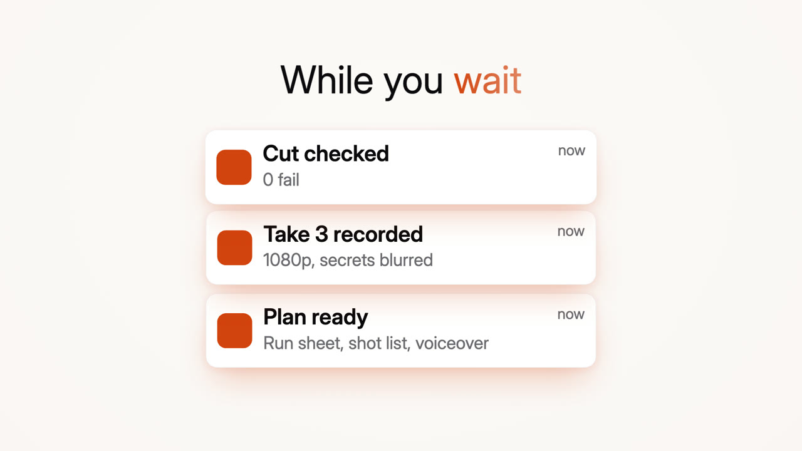
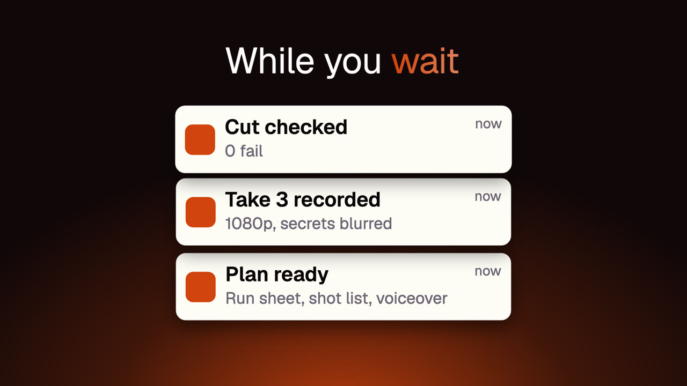
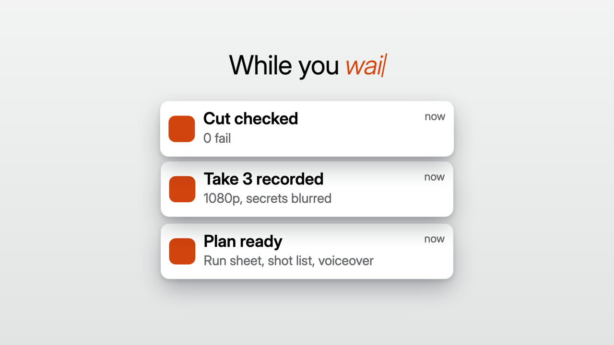

# Launch ads (motion)

[Back to the README](../README.md)

Turn a JSON storyboard into a beat-synced motion-graphics ad of your product, in 16:9, 4:5 and 9:16,
in one of several house styles. Every pixel is rendered by headless Chrome from HTML and CSS, one frame
at a time, so a render is exact and repeatable. Your product shows up as real screenshots and real
screen recordings; the engine draws only type, panels, cursors, confetti and backgrounds.

```
node motion/render-motion.mjs examples/launch-ad/storyboard.json --size 16x9 --out /tmp/launch-ad-16x9.mp4
```

Needs what the rest of demo-studio needs: Node 20+, ffmpeg/ffprobe, Google Chrome and the repo's
`playwright-core` (`npm install` once). No other dependencies: easing, beat analysis, the validator and
the SFX kit are plain Node.

## Contents

1. [How it works](#how-it-works)
2. [Quick start](#quick-start)
3. [Storyboard format](#storyboard-format) (with a full example)
4. [Scene types](#scene-types) (every parameter)
5. [Styles](#styles) and [adding a style](#adding-a-style)
6. [Rendering each size](#rendering-each-size)
7. [Music, beat sync and sound](#music-beat-sync-and-sound)
8. [Checks: validation, text fitting, determinism, tests](#checks)
9. [Files](#files)

## How it works

```
storyboard.json ──validate (schema + files on disk)──┐
motion-templates/<name>/style.json ──validate──────────────────┤
music ──analyze-beats.mjs──> beats.json (bpm, phase) ─┤
                                                      ▼
                     render-motion.mjs: resolve scene times on the beat grid
                     prepare media (clips -> JPEG frames, crops) into .motion-cache/ next to the storyboard
                     open engine/index.html in Chrome at the target size
                     for each frame: motion.seek(t) -> screenshot -> ffmpeg (H.264 CRF 16)
                     collect SFX cues from scenes, mix with music, loudnorm two-pass, mux
```

The runtime (`engine/runtime.js`) builds every scene once, then `seek(t)` sets every element from `t`
alone: no wall clock, no `requestAnimationFrame`, no randomness (confetti and scatter layouts use a
seeded generator). Clip frames are swapped per frame and the screenshot waits for them to decode, so
there are no unloaded-image flashes.

Sizes are in `u`, 1% of the frame's shorter side, so a layout re-flows for 4:5 and 9:16 instead of
being letterboxed. Scenes check `ctx.portrait` and re-arrange (tiles go to two columns, devices
centre, headlines move above panels).

## Quick start

From the plugin root (`$P`):

```
node motion/analyze-beats.mjs my-ad/music.mp3 --out my-ad/music.beats.json
node motion/render-motion.mjs my-ad/storyboard.json --check                    # validate only
node motion/render-motion.mjs my-ad/storyboard.json --size 16x9 --stills 1,4.5,9 --stills-dir my-ad/stills
node motion/render-motion.mjs my-ad/storyboard.json --size 16x9 --out my-ad/out/ad-16x9.mp4
node motion/contact-sheet.mjs my-ad/out/ad-16x9.mp4 --fps 4                    # review sheet
```

A render prints progress on stderr, then one JSON line such as
`{"ok":true,"style":"airy","duration":36,"bpm":119.999,"scenes":13,"out":".../ad-16x9.mp4","loudness":{"integrated":-14,"truePeak":-1.4}}`.
Try it on the sample: `node motion/render-motion.mjs examples/launch-ad/storyboard.json --size 9x16 --out /tmp/launch-ad-9x16.mp4`.

`--stills` renders just those times to PNG, which is the fast way to iterate on layout.
`--from`/`--to` render a window (used for the style samples). `--style <name>` swaps the look
without touching the storyboard. `--no-audio` skips the mix.

## Storyboard format

Paths are relative to the storyboard file. Text marks accent words with asterisks:
`"Every demo took *an afternoon.*"`. Every in-scene time called `at` (and `typeFrom`, `clickAt`,
`zoomAt`, `every`, ...) is in **beats** when the storyboard has a tempo, otherwise in **seconds**.

Top level:

| Field | Type | Meaning |
|---|---|---|
| `version` | `1` | Required. |
| `title` | string | For humans. |
| `style` | string | Folder under `motion-templates/`. Default `airy`. `--style` overrides. |
| `fps` | int | Default 30. |
| `brand.name` | string | Required. Used by `logoLockup`. |
| `brand.accent` | `#rrggbb` | Required. Accent words, fills, glows, confetti, background tint. |
| `brand.accentInk` | `#rrggbb` | Text on accent fills. Default white. |
| `brand.logo` | path | Logo mark (svg/png) for `logoLockup`. |
| `brand.url` | string | Shown under the lock-up. |
| `brand.fonts.display` / `.body` | `{family, src, weight}` | Optional. Your own font files; otherwise the style's fonts. |
| `timing.beatsFrom` | path | `beats.json` from `analyze-beats.mjs`; fills `bpm` and `offset`. |
| `timing.bpm`, `timing.offset` | number | Tempo and first-beat second, if you know them. |
| `timing.start` | number | Second at which scene 1 starts (default: the first beat). |
| `timing.tail` | number | Seconds held after the last scene. |
| `audio.music` | path | Music bed. `musicStart` (s) skips into it; `musicGainDb`; `fadeOut` (s). |
| `audio.sfx` | `{cue: path}` | Optional: your own files for the cue names scenes emit (see below). Without it the built-in synthesised kit is used. |
| `audio.sfxGainDb` | number | SFX level relative to music, default -10. |
| `audio.loudness`, `audio.truePeak` | number | Loudnorm target, default -14 LUFS and -1.5 dBTP. |
| `scenes` | array | Required, in order. |

Every scene has `type`, and either `beats` or `duration` (seconds). Optional on every scene:
`exit` (`auto` = the style's transition, or `blurScale`, `whip`, `zoomThrough`, `fade`, `cut`),
`tone` (`light`/`dark`: switch palettes for this scene; the background cross-fades), `sfx: false`
to mute its cues, `id`, `note`.

**Media** values are an image path (png, jpg, webp, svg), a video or GIF path, or a clip object
`{ "src": "take.mp4", "from": 12.2, "to": 18.6, "rate": 1.6, "crop": [x, y, w, h] }` (crop in
fractions). A still from a video is `{ "src": "video.mp4", "from": 5, "to": 5.04 }`.

Full example (a complete, valid storyboard; `examples/launch-ad/storyboard.json` is a real one):

```json
{
  "$schema": "../schema/storyboard.schema.json",
  "version": 1,
  "title": "Acme launch",
  "style": "airy",
  "brand": {
    "name": "Acme",
    "accent": "#2f6bff",
    "logo": "../assets/acme-mark.svg",
    "url": "acme.example"
  },
  "timing": { "beatsFrom": "../audio/music.beats.json", "start": 0 },
  "audio": {
    "music": "../audio/music.mp3",
    "fadeOut": 1.2,
    "sfxGainDb": -14
  },
  "scenes": [
    { "type": "kineticText", "beats": 8, "phrases": [ { "text": "Reports used to take", "at": 0 }, { "text": "*all week.*", "at": 3 } ] },
    { "type": "promptType", "beats": 6, "text": "Summarise last month's sales by region.", "typeFrom": 0.5, "typeTo": 4, "clickAt": 5 },
    { "type": "tiles", "beats": 6, "labels": ["Fetch", "Clean", "Chart", "Write"], "status": "Ready in 40 seconds" },
    { "type": "doneBurst", "beats": 3, "label": "Done" },
    { "type": "tiltedPanel", "beats": 5, "media": { "src": "../footage/report.mp4", "from": 3, "to": 6 },
      "cursor": [ { "at": 1, "point": [0.5, 0.5] }, { "at": 2.5, "point": [0.82, 0.1], "click": true } ] },
    { "type": "uiFocus", "beats": 6, "media": "../shots/editor.png", "focus": [0.6, 0.1, 0.35, 0.4], "headline": "*Edit* anything." },
    { "type": "aspectMorph", "beats": 4, "media": "../shots/report.png", "ratios": ["16:9", "4:5", "9:16"] },
    { "type": "kineticText", "beats": 3, "mode": "build", "phrases": [ { "text": "Fast.", "at": 0 }, { "text": "*Private.*", "at": 1 } ] },
    { "type": "logoLockup", "beats": 6, "exit": "cut" }
  ]
}
```

## Scene types

Times below are beats when the storyboard has a tempo, else seconds. "Default" spreads a value over
the scene. Each scene's SFX cue names are in brackets.

| Type | What it shows | Parameters |
|---|---|---|
| `kineticText` | Centred headline revealed word by word in the style's reveal (blur-in, typewriter or rise); phrases replace each other, or build one sentence. [`swish` per phrase, `pop` for the mark] | `phrases` (required): strings or `{text, at}`; `mode`: `replace` (default) or `build`; `size`: `hero`/`title`/`body`; `reveal`: `style`/`blur`/`type`/`rise`; `mark`: logo image that pops in above; `markAt`. |
| `cardScatter` | Cards fly in with 3D spin and blur, settle around a headline and drift. [`whoosh`] | `images` (2 to 9 media, required); `phrases` (headline, built one phrase at a time); `layout`: `scatter`/`orbit`/`row`/`grid`. |
| `promptType` | One isolated input box: the prompt types out with a caret, the cursor clicks send. [`typing`, `whoosh`, `click`] | `text` (required); `placeholder`; `label` (headline above); `typeFrom`, `typeTo`, `clickAt`. |
| `tiles` | A row (or 2-column grid in portrait) of numbered tiles that light up in turn, a progress bar, a status line. [`tick` per tile] | `labels` (2 to 8, required); `status`; `progressLabel` (shows a % counter); `every` (gap between tiles). |
| `doneBurst` | Word above a check that draws itself, with a confetti burst or a drawn ring. [`pop`] | `label` (default Done); `sub`; `variant`: `confetti`/`ring` (default from the style). |
| `tiltedPanel` | A screenshot or clip in a floating window with 3D tilt, entry from a steeper angle, slow drift; optional cursor path and corner badge. [`whoosh`, `click`] | `media` (required); `chrome`: `window`/`plain`; `tilt`: `[rx, ry, rz]` deg; `headline`, `headlinePosition`: `above`/`below`; `cursor`: `[{at, point:[x,y], click}]` (point in media fractions); `badge`. |
| `uiFocus` | The panel straightens and the camera dives into one region, the rest dims, an accent ring marks it; optional synthetic click and headline. Use a clip to show a real interaction. [`whoosh`, `swish`, `click`] | `media`, `focus: [x, y, w, h]` (required); `zoomAt`; `click: [x, y]`, `clickAt`; `headline`, `headlineAt`. |
| `aspectMorph` | One frame morphing between aspect ratios with big ratio labels; crossfades per-ratio media if given. [`swish`] | `ratios` (default 16:9, 4:5, 9:16); `media` or `medias` (one per ratio); `showLabels`. |
| `statCounter` | A big number counting up with a glowing bar and a label. [`tick`] | `to` (required); `from`, `decimals`, `prefix`, `suffix`, `label`, `bar`. |
| `logoLockup` | Logo mark pops and slides, name reveals beside it (stacked in portrait), URL pill fades up. [`hit`] | `logo`, `name`, `url` (default from `brand`); `tagline`. |
| `deviceFrame` | Media inside a phone, laptop, monitor or tablet that swings in, with a headline beside or above. [`whoosh`] | `media` (required); `device`: `phone`/`laptop`/`monitor`/`tablet`; `side`: `left`/`right`/`center`; `headline`. |
| `featureList` | Title and checked items sliding in one by one, optional panel beside (above in portrait). [`tick` per item] | `items` (2 to 6, required); `title`; `media`. |
| `notificationStack` | Notification cards dropping in and stacking. [`tick` per card] | `items` (`{title, body, meta, icon}`, 1 to 5, required); `headline`. |
| `chartReveal` | Bars growing with counting values; one highlighted in the accent. [`whoosh`] | `values` (required); `labels`, `unit`, `title`, `highlight` (index, default the max). |
| `buttonPress` | One isolated button; the cursor clicks it; the label swaps to a result. [`click`] | `label` (required); `resultLabel`; `variant`: `solid`/`glow`/`outline`; `clickAt`; `headline`. |
| `sparkle` | A four-point star zooms through the frame and throws small stars: a beat-long transition. [`sparkle`] | `count` (small stars, 1 to 5). |

Every scene also gets the style's camera push (`motion.drift`) and its exit transition.

## Styles

A style is `motion-templates/<name>/style.json` (schema: `motion/schema/style.schema.json`) plus `ANALYSIS.md`, the
measured study it was built from, and `preview/` stills from the gallery storyboard. Styles never name
a product: brand colour, logo and (optionally) fonts come from the storyboard, so one style serves any
product. The background picks up a little of the brand accent (`background.tint`).

| Style | Look | Reveal | Transition | Done |
|---|---|---|---|---|
| `airy` (default) | Near-white with a faint brand tint, accent-coloured glow under floating UI, accent border on cards, gradient accent words. | Words blur-zoom in from 2x (433 ms), one every 300 ms; the line stays centred as it grows | Scale down to 0.48 + blur (333 ms) | Confetti |
| `nocturne` | Near-black with the accent glowing up from the bottom edge; warm-white cards with an accent glow; big light type; flips to light for the in-app section and the lock-up. | Typewriter, 68 ms per character, caret | Zoom through with blur | Glowing ring |
| `showroom` | Gallery grey with a floor gradient, and a deep-blue lit stage for product moments; slanted light accent word; devices start on the screen and pull back. | Typewriter, 100 ms per character, caret | Hard cut | Ring |

Preview stills of the scene types in each style (from `examples/motion-gallery/storyboard.json`) are in
`motion-templates/<name>/preview/01.jpg` to `10.jpg`:





Each style's `ANALYSIS.md` lists the measured numbers and, in its section 8, which number each
`style.json` value comes from.

Fonts come from the repo (all SIL OFL): Inter and Geist in `assets/fonts/`, Bricolage Grotesque and
Schibsted Grotesk in `site/fonts/`. A style's `fonts.*.file` is a file name in one of those folders.

### Style fields

| Field | Meaning |
|---|---|
| `tone` | `light` or `dark`: the default palette. Scenes can switch with `tone`. |
| `palette.light` / `palette.dark` | `bg`, `bg2` (gradient partner), `ink`, `muted`, `panel`, `panelInk` + `panelMuted` (text on panels when panels contrast with the stage), `line`, `shadowTint` (a colour or `accent`), `glow`. |
| `palette.confetti` | Colours, or `accent`, `accentLight`, `accentDark`. |
| `fonts.display` / `fonts.body` | `{family, file, weight, accentWeight}`; `file` is in `assets/fonts/` or `site/fonts/`. |
| `fonts.accent` | How accent words differ: `color`, `italic` (slanted by `accentSkew` degrees at `accentWeight`) or `gradient`. |
| `type` | `hero`, `title`, `body`, `small` in u; `minPx` floor at 1080 px (keep 44+ for phones); `tracking` (em); `lineHeight`. |
| `text` | `reveal` (`blur`/`type`/`rise`), `wordMs` (one word's entry), `staggerMs`, `ease` (cubic-bezier array or name), `blurPx`, `rise` (u), `scaleFrom`, `charMs` + `caret` (typewriter; speeds up when a phrase has less time). |
| `motion` | `enterMs` + `enterEase` (panels, cards), `exitMs` + `exitEase`, `exitScale` (for `blurScale`), `transition` (`blurScale`, `whip`, `zoomThrough`, `fade`, `cut`), `drift` (camera scale change per second on holds; negative pulls back), `popMs` + `popEase` (checks, logo marks), `deviceEntry` (`rise` or `pullBack`). |
| `panel` | `radius` (share of panel width), `tilt` `[rx, ry, rz]`, `perspective` (px), `shadow` (CSS with `U` units; `TINT` is the palette shadow colour and takes a hex alpha suffix, e.g. `TINT4d`), `border` (`LINE` = palette line, `ACCENT` = brand accent), `glow` (`ACCENT` = brand accent), `chromeBar`. |
| `background` | `kind` (and `darkKind` for dark scenes): `flat`, `radialCentre`, `radialBottom`, `linear`, `sky`; `glowAccent` (glow uses the accent); `tint` (0 to 0.3 of the brand accent mixed into the background). |
| `sceneTones` | Default tone per scene type, e.g. `{"deviceFrame": "dark"}`; a scene's own `tone` wins. |
| `cursor` | `hand` or `arrow`. `doneVariant`: `confetti` or `ring`. `deviceTone`: bezel colour. |

### Adding a style

1. Study a reference you like (style only; never copy its assets, words or brand). The scripts in
   `motion/analysis/` measure shot lengths, colours, type sizes, easing curves, tempo and cut-to-beat offsets;
   write the numbers into `motion-templates/<name>/ANALYSIS.md`.
2. Copy `motion-templates/airy/style.json` to `motion-templates/<name>/style.json`, give it an original name, and set each
   value from the analysis (say where each number came from in ANALYSIS.md).
3. `npm run test:motion` (checks every style against the schema; add your style name to the list in
   `tests/test_motion_validate.mjs`).
4. Compare: `bash motion/analysis/side-by-side.sh <ref.mp4> examples/motion-gallery/storyboard.json <name> /tmp/sbs.jpg "refT:ourT ..."`
   puts reference frames next to yours for matching scene types; adjust until layout, scale and depth match.
5. Render the gallery in it and read the sheet:
   `node motion/render-motion.mjs examples/motion-gallery/storyboard.json --style <name> --size 16x9 --out /tmp/gallery-<name>.mp4 --no-audio`
   then `node motion/contact-sheet.mjs /tmp/gallery-<name>.mp4 --fps 2`.
6. Save preview stills to `motion-templates/<name>/preview/` (`--stills ... --stills-dir ...`, then shrink to 1280 px JPEG).

### Adding a scene type

Add `{ defaults, build(root, params, ctx, duration) -> { update(t) } }` to a file in
`motion/engine/scenes/`, register it in `motion/engine/scenes/index.js`, and describe its params in
`motion/schema/storyboard.schema.json` (`$defs` + the `allOf` switch + the `type` enum). `update(t)` must
depend on `t` only. Use `ctx.cue(t, name)` for sounds and the helpers in `motion/engine/kit.js` (text blocks
with fitting, media, panels, cursor, confetti, stars).

## Rendering each size

```
for s in 16x9 4x5 9x16; do
  node motion/render-motion.mjs my-ad/storyboard.json --size $s --out my-ad/out/ad-$s.mp4
done
```

| `--size` | Pixels |
|---|---|
| `16x9` | 1920 x 1080 |
| `4x5` | 1080 x 1350 |
| `9x16` | 1080 x 1920 |
| `1x1` | 1080 x 1080 |

Output is H.264 CRF 16, yuv420p, faststart, AAC 192k. Frames are piped straight from Chrome to
ffmpeg, so nothing piles up on disk. Clip frames are cached in `.motion-cache/` next to the storyboard and shared by all sizes;
delete it when you are done. A 36 s ad at 1080p takes a few minutes per size on a laptop. Run one
render at a time.

## Music, beat sync and sound

1. `node motion/analyze-beats.mjs music.mp3 --out music.beats.json` decodes the track, builds a
   spectral-flux onset envelope (1024-point FFT, 256-sample hop at 22.05 kHz), finds the tempo by
   autocorrelation (70 to 180 BPM, gently preferring 120), then refines tempo and phase with a
   least-squares fit of the strong onsets to the eighth-note grid. It writes `bpm`, `offset` (second of
   the first beat) and the strong `onsets`.
2. Point `timing.beatsFrom` at it and give scenes `beats` instead of `duration`. Scene `n` starts at
   `start + (sum of earlier beats) * 60 / bpm`, rounded to the frame grid (never more than half a frame
   off the beat, with no drift). With `start` unset, scene 1 starts on the first beat.
3. Put big moments on bar lines (every 4 beats). Use the track's own structure: in the demo-studio ad
   the music stops for one bar at 15 s, so a 2-beat `sparkle` sits in that break and the pipeline lands
   on the drop.
4. Scenes emit named cues (`whoosh`, `swish`, `click`, `tick`, `pop`, `hit`, `sparkle`, `typing`) at the
   exact frame of the event. The built-in kit is synthesised with ffmpeg by `motion/make-sfx.mjs` on
   the first render (into `motion/sfx/`, git-ignored), so there is nothing to license; `audio.sfx`
   maps names to your own files instead. `<out>.timeline.json` lists every scene
   time and cue.
5. The mix is music + cues (`sfxGainDb` under the music), then EBU R128 loudnorm in two passes
   (measure, then apply linear gain) to `audio.loudness` LUFS and `audio.truePeak` dBTP.

## Checks

- **Validation before render.** `render-motion.mjs` checks the storyboard and style against the
  schemas, checks that every referenced file exists and is the right kind, and checks timing rules.
  Errors name the path, e.g. `scenes[3].labels: expected at least 2 item(s), got 1` or
  `scenes[7].media.src: file not found: take.mp4`. Nothing renders until all are fixed. `--check`
  runs only this.
- **Text never clips.** Headlines wrap (keeping phrases together, balancing line lengths) and shrink in
  4% steps down to `type.minPx` (44 px at 1080 wide). If text still does not fit, the render stops and
  names the scene and text. Tile labels and button labels shrink to fit the same way.
  `examples/motion-gallery/long-headline.json` exercises this in 9:16.
- **Determinism.** Rendering the same frame twice gives the same PNG bytes (seeded randomness, no
  clocks, fonts and images awaited). Check with `--stills` twice and `shasum`.
- **Tests.** `npm run test:motion` (node:test, no browser): validator errors and asset checks, beat
  grid and tempo maths on synthetic click tracks, easing, and text fitting.

## Files

```
motion/render-motion.mjs     CLI: validate, time, prepare media, render frames, mix, mux
motion/analyze-beats.mjs     music -> beats.json
motion/make-sfx.mjs          synthesised SFX kit -> motion/sfx/*.wav (run automatically)
motion/contact-sheet.mjs     review sheet of a video
motion/engine/               the page Chrome renders: runtime.js (scenes, seek, backgrounds,
                             transitions, camera), kit.js (text fitting and reveals, media, panels,
                             cursor, confetti, stars), scenes/*.js (the 16 scene types)
motion/lib/                  validate, timing, easing, fit, beats, assets, server, mix (Node)
motion/schema/               storyboard.schema.json, style.schema.json
motion/analysis/             scripts that measure a reference ad; side-by-side.sh
motion-templates/<name>/     style.json, README.md, ANALYSIS.md, measurements.json, preview/
examples/launch-ad/          the demo-studio launch ad: storyboard.json + media/
examples/motion-gallery/     every scene type once (the preview set) and a long-headline test
tests/test_motion_*.mjs      node:test suites
```
