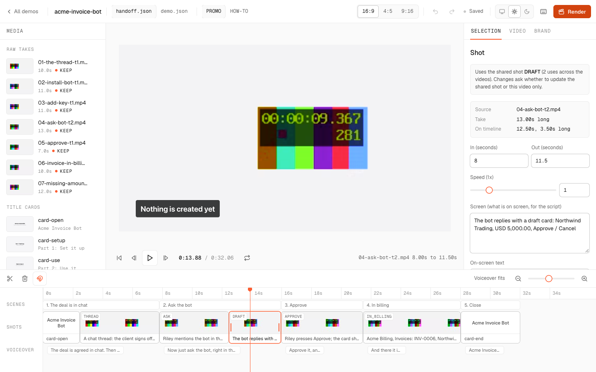
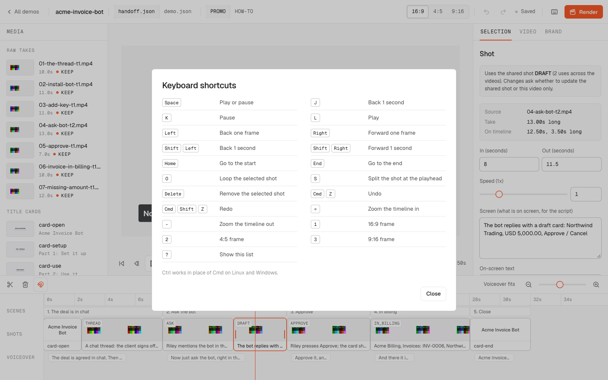

# The studio (dashboard and editor)

[Back to the README](../README.md)

## Home screen

A local page that shows every demo in your folder and where each one stands. Run it from the folder
you start Claude Code in (or from inside the demos folder):

```bash
npm --prefix "$P" run studio        # opens http://127.0.0.1:4317
```


Each card shows the demo's picture, its status from the index, the stages with the next one
outlined, anything that needs attention (takes nobody reviewed, throwaways not cleaned up, frames
left on disk), and the sentence to give Claude for the next step, with a copy button. From a card
you can open the editor, play a video, open the planning documents or show the folder. With no
demos yet, it shows the four steps to make the first one. It only reads your files, and it runs on
your machine only (`127.0.0.1`).

## Local editor

A local web app for reviewing and tweaking a cut without rendering. Open a demo folder, watch the
edit play in real time, trim and reorder shots, edit on-screen text and voiceover, check the 4:5 and
9:16 framing, then press Render to run the same scripts Claude runs.

```bash
npm run studio demos/acme                     # or: npx demo-studio demos/acme
npm run studio                                # no folder: the home screen, for $DEMO_ROOT (default ./demos) and examples/
npm run studio demos/acme -- --port 4400 --no-open
```

It serves on `127.0.0.1` only (port 4317, or the next free one). The first run builds the UI, which
takes a few seconds. To try it without footage, copy the example and make small synthetic takes:

```bash
cp -R examples/acme-invoice-bot /tmp/acme && node app/scripts/example-media.mjs /tmp/acme
npm run studio /tmp/acme
```



| 9:16 framing | Render drawer | Keyboard shortcuts |
| --- | --- | --- |
|  |  |  |

**Layout.** Top bar: the demo, a tab per file (`handoff.json`, `demo.json`), a tab per video, the
aspect switch, undo and redo, save status and Render. Left: raw takes (with keep, alt and reject
from `takes.csv`), title cards and named shots; drag them onto the timeline. Center: the preview,
which plays the clips with their in and out points and speed, draws title cards and on-screen text,
and frames 4:5 and 9:16 the way `social-cut.py` does. Bottom: the timeline, with a voiceover lane
that turns red when a line runs past the next narrated scene. Right: the inspector.

**Your files stay the source of truth.** The editor reads and writes `handoff.json` and `demo.json`
in the schema shape, keeping `_comment` and other `_` keys. It saves about a second after each edit
(to a temp file, then renamed), checks the file against the schema first and never writes an
invalid one. If Claude changes the file while it is open, the editor reloads it, or asks which
version to keep when you have unsaved edits. Editing a shot that uses `{"ref": ...}` asks whether
to change the shared shot (every video) or only this video.

**Render** runs `title-cards.mjs`, `build-handoff.py`, `build-keynote.py`, `review-reel.py` or
`social-cut.py`, one at a time, with a progress bar, the log, the output in a player, and Reveal in
Finder and Open buttons. Cancel stops the script and everything it started. **Quick preview**
renders the current video at 960x540 with fast settings, for a faithful check of speed changes and cards.

| Keys | Action |
| --- | --- |
| Space, K, L | Play or pause, pause, play |
| J, Shift+Left, Shift+Right | Back 1 second, back 1 second, forward 1 second |
| Left, Right | One frame back or forward |
| Home, End | Start, end |
| O, S, Delete | Loop the selected shot, split at the playhead, remove the shot |
| Cmd+Z, Cmd+Shift+Z | Undo, redo |
| =, - | Zoom the timeline |
| 1, 2, 3 | 16:9, 4:5, 9:16 |
| ? | Show the shortcuts |

Limits: the preview has no audio and does not draw the keynote cut's zooms or dissolves; use Quick
preview or the real render for those. It is tested in Chrome, for the same machine only.
