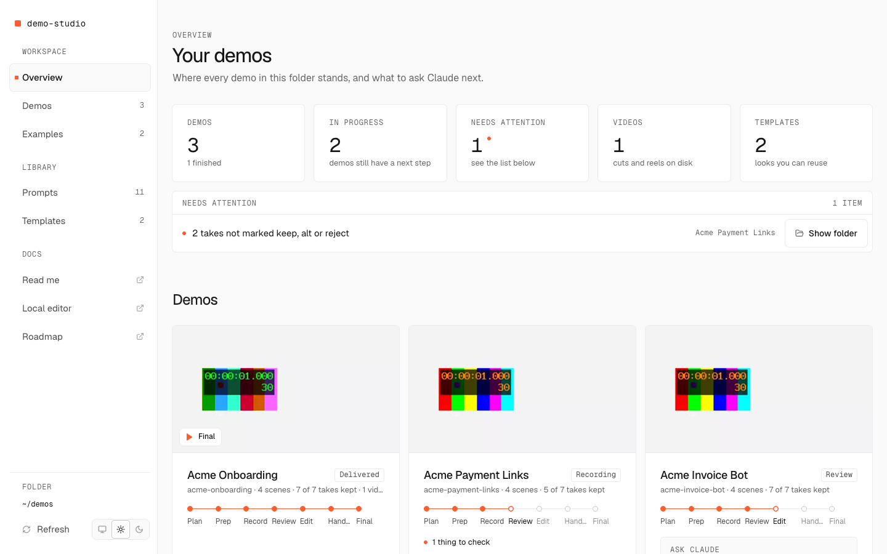
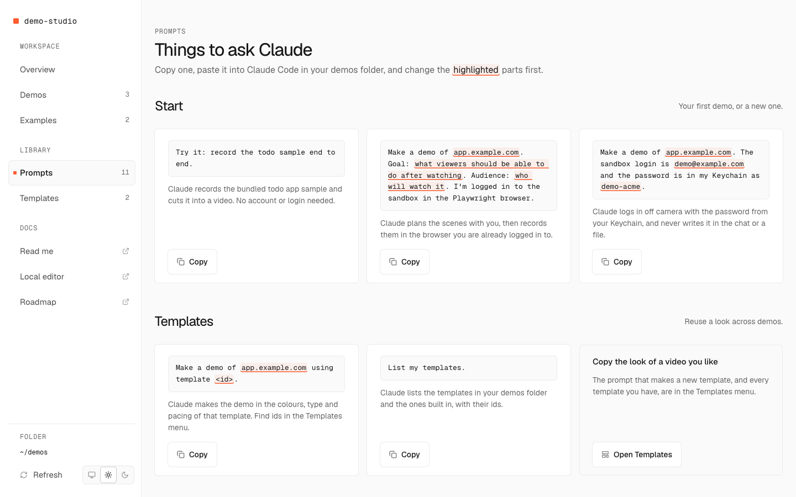
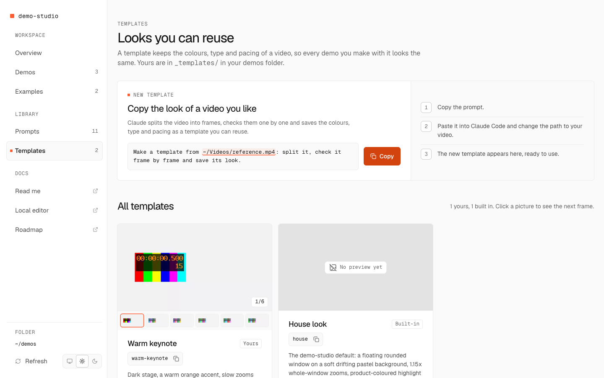
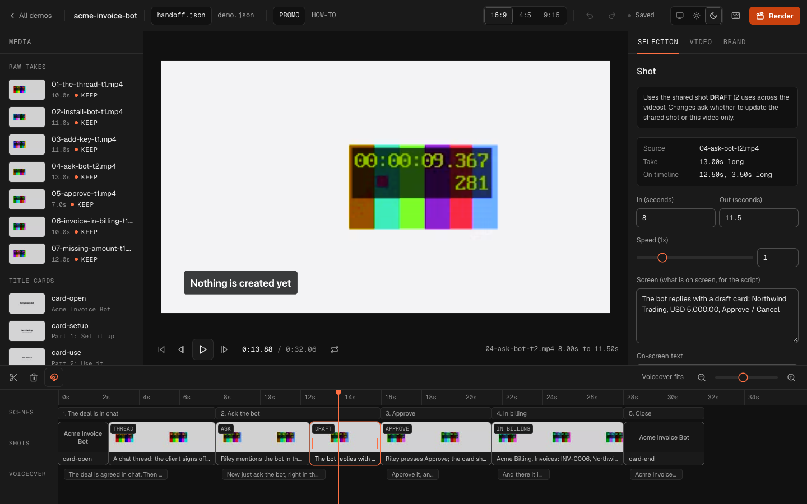
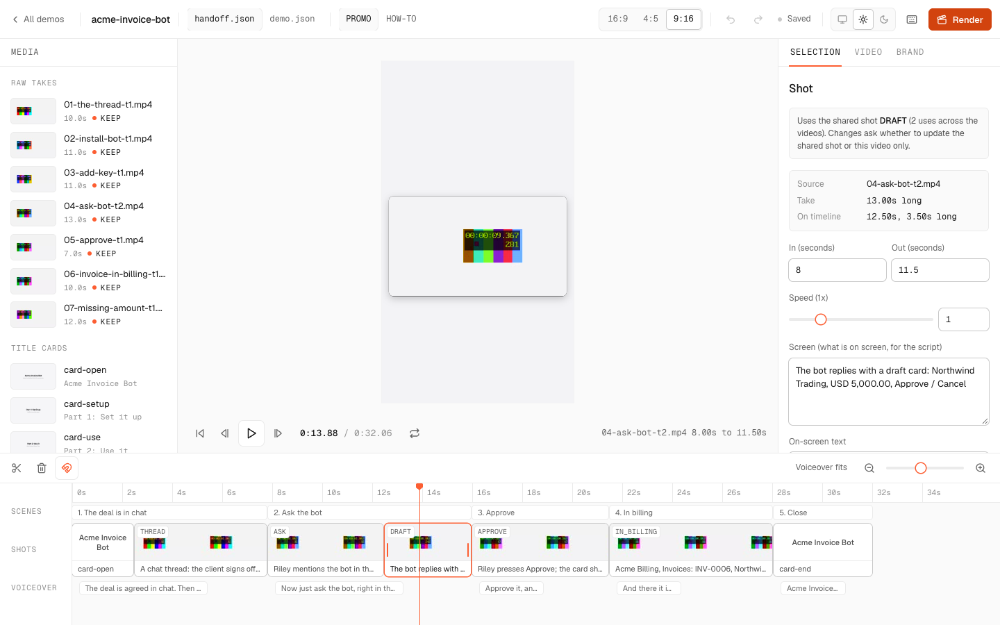
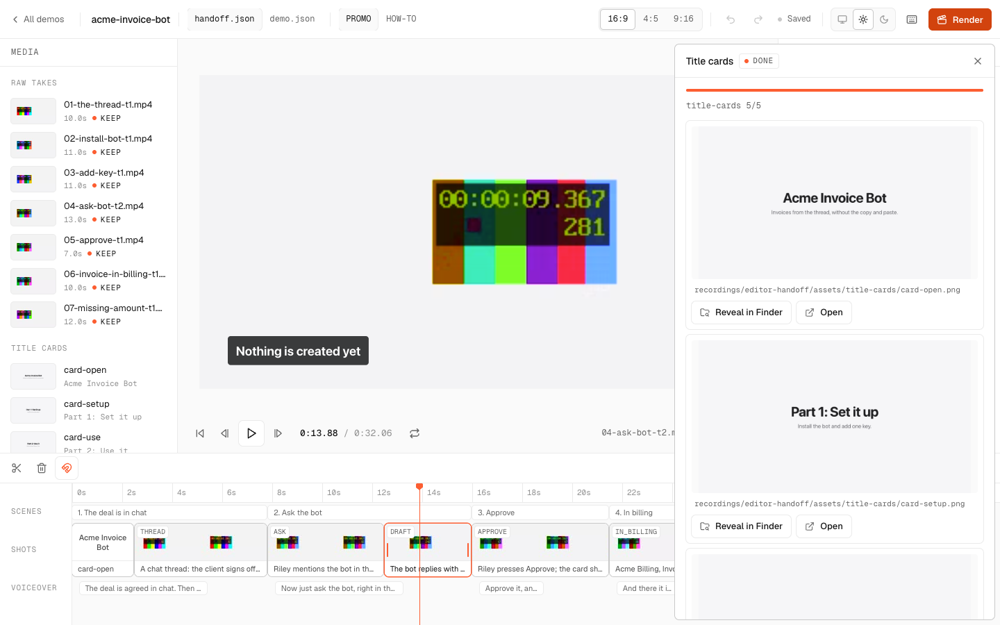
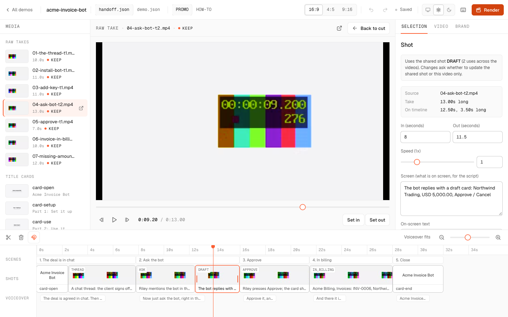

# The studio (dashboard and editor)

[Back to the README](../README.md)

## Home screen

A local page that shows every demo in your folder and where each one stands. Run it from the folder
you start your agent in (or from inside the demos folder):

```bash
npm --prefix "$P" run studio        # opens http://127.0.0.1:4317
```



Each card shows the demo's picture, its status from the index, the stages with the next one
outlined, anything that needs attention (takes nobody reviewed, throwaways not cleaned up, frames
left on disk), and the sentence to give your agent for the next step, with a copy button. From a card
you can open the editor, play a video, open the planning documents or show the folder. With no
demos yet, it shows the four steps to make the first one. It only reads your files, and it runs on
your machine only (`127.0.0.1`).

### Prompts

The Prompts menu holds ready-to-copy things to ask your agent, grouped as Start, Templates, Fix and
finish, and Housekeeping. Each card shows the prompt, one line on what the agent then does, and a Copy
button. The parts to change, such as `app.example.com` or a scene number, are highlighted, so you
know what to edit after pasting.



### Templates

A template keeps the look of a video (colours, type, pacing) so every demo made with it looks the
same. The Templates menu lists yours, from `_templates/` in your demos folder, and the built-in
ones from the plugin's `look-templates/`. Each card shows its preview frames (click the picture for
the next one), its name and id with a copy button, where it was copied from, and its colours.
**Use** copies ``Make a demo of app.example.com using template `<id>`.`` with the id filled in.

To make a new one, copy the prompt at the top of the menu, paste it into your agent with the path
to your video, and the template appears in the list when the agent has saved it. The menu only reads
`template.json`, `source.json` and the six preview PNGs; it never serves other files from a
template folder, and skips folders that are symlinks.



## Local editor

A local web app for reviewing and tweaking a cut without rendering. Open a demo folder, watch the
edit play in real time, trim and reorder shots, edit on-screen text and voiceover, check the 4:5 and
9:16 framing, then press Render to run the same scripts your agent runs.

```bash
npm run studio demos/acme                     # or: npx demo-studio demos/acme
npm run studio                                # no folder: the home screen, for $DEMO_ROOT (default ./demos) and examples/
npm run studio demos/acme -- --port 4400 --no-open
```

It serves on `127.0.0.1` only (port 4317, or the next free one). The first run builds the UI, which
takes a few seconds. To try it without footage of your own, open the home screen and press **Try a
copy** on an example: it copies the example into your demos folder, gives every take that has no
footage a sample slate (the shot's name and what it shows, with a bar sweeping across), and opens the
copy. The example itself is never edited. From a terminal, the same thing:

```bash
cp -R examples/acme-invoice-bot demos/acme && node app/scripts/example-media.mjs demos/acme --slates
npm run studio demos/acme
```


System, Light and Dark themes: switch them in the dashboard sidebar or the editor's top bar.



| 9:16 framing | Render drawer | Keyboard shortcuts |
| --- | --- | --- |
|  |  |  |

**Layout.** Top bar: the demo, a tab per file (`handoff.json`, `demo.json`), a tab per video, the
aspect switch, undo and redo, save status and Render. Left: raw takes (with keep, alt and reject
from `takes.csv`), title cards and named shots; drag them onto the timeline. Center: the preview,
which plays the clips with their in and out points and speed, draws title cards and on-screen text,
and frames 4:5 and 9:16 the way `social-cut.py` does. Bottom: the timeline, with a voiceover lane
that turns red when a line runs past the next narrated scene. Right: the inspector.

**Which file opens.** The editor opens on `handoff.json` unless it is still the template from
`new-demo.sh` (its title is still "Product name"); then it opens on `demo.json`, where a
keynote-only cut lives. If the file you are looking at is still the template, a banner above the
timeline says so and offers the other file when that one is filled in.

**Checking raw takes.** Click a take in the bin (or focus it and press Enter) to watch the whole
take at real speed in the preview, with its own scrubber, frame step and length. Space, J, K, L and
the arrow keys drive it while it is open; Esc or Back to cut returns to the cut where you left it.
When a timeline shot that uses the take is selected, Set in and Set out (I and O) move that shot's
in or out point to the current frame. Double-click a take, or use its open button, to play it in
the system player. Dragging a take onto the timeline works as before.



**Your files stay the source of truth.** The editor reads and writes `handoff.json` and `demo.json`
in the schema shape, keeping `_comment` and other `_` keys. It saves about a second after each edit
(to a temp file, then renamed), checks the file against the schema first and never writes an
invalid one. If your agent changes the file while it is open, the editor reloads it, or asks which
version to keep when you have unsaved edits. A shot that uses `{"ref": ...}` (a shared shot) is
changed in this video only, unless the inspector's "Changes apply to" switch is set to all uses; a shared
shot used just once is simply edited.

**Moving and editing text.** On-screen text (`handoff.json`) and caption pills (`demo.json`) sit on
the preview as boxes you can work with directly. The toolbar above a selected box stays inside the
preview: it slides along at the side edges and drops below the text at the top. Click one to select it, drag it to move it, and
double-click it (or press Enter) to type a new line; Enter saves, Esc cancels. While you drag, it
snaps to the centre lines, the 5% safe margins and its default spot, with an orange guide; hold Alt
to place it freely. Arrow keys nudge it 1 px (Shift: 10 px). On-screen text also has a corner handle
and a size control. The small toolbar above a selected box centres it across or down, or puts it back
in its default spot. Double-click an empty part of the frame to add text to a shot that has none.
Positions are saved as `text_pos` and `text_size` on the shot, or `caption_pos` (and `pos` on a
callout) in `demo.json`, as fractions of the frame. The keynote render puts a moved pill exactly
there; `check-cut.py` lists it as LOOK, because the quality bar wants pills under the window (C1).
The editor script from `build-handoff.py` gives the place and size next to each line.

**Pill timing.** On a `demo.json` scene with a pill, the inspector has a "Pill timing" group under
Caption. Choose "At a time" and type the seconds into the scene, or "On a spoken word" and pick a word
of that scene's voiceover from the list (a word said twice is listed as 1st and 2nd). An offset moves
the pill a little earlier or later than the word. It is saved as the callout's `at`, as a number or as
`{"word", "nth", "offset"}`. The "Lands about" line is an estimate from the word rate; the build
measures the real line. If the word leaves the voiceover, the group says the build will stop.

**Fonts.** The toolbar of a selected text has a Font menu: Inter (the default), Inter Display, Geist,
Geist Mono and Figtree are built in. To add your own, put the font file (`.woff2`, `.woff`, `.ttf` or
`.otf`) in the demo's `fonts/` folder, or ask your agent to; it shows up under "This demo" the next time the
editor window is focused. The choice is saved as `text_font` (or `caption_font` and callout `font` in
`demo.json`).

**The export matches the preview.** The preview, the exports and the keynote render draw text with the
same CSS (`app/shared/text-style.mjs`) and the same font file, and place it with the same rule: its
centre at the saved point, pushed back inside the frame if it has grown past an edge. Quick preview
burns the text in; `build-handoff.py` writes each text as a transparent 1920x1080 PNG in the video's
`text/` folder (named by clip number) for the editor to lay over the clip; the keynote render draws
pills in place. The editor e2e checks the exported PNG lands within 1.5 px of the preview.

**Render** (top right) lists what you can export, grouped by what you get: a Quick preview of the
current video (960x540, fast, with its on-screen text, to check timing), the Keynote video and the
Social media versions (finished videos), and the title cards as images and the review reel of all kept
takes. Each says its format, size and the folder it lands in. Exports run one at a time with a
progress bar, the log, the output in a player, and Reveal in Finder and Open buttons; Cancel stops the
script and everything it started. The full editor handoff package is still made by
`build-handoff.py` (ask your agent for it); Social media versions build the rough assemblies they need.

When an export finishes, the drawer checks each finished video with `video-gate.py`, and a keynote cut
that has its `.plan.json` next to it also with `check-cut.py`, one after the other. Under the video you
see a line such as "1 needs fixing, 2 worth a look" (or "All checks pass"); open it to read each row,
and the passing rows are behind "Show N passing". If a checker cannot run, the drawer says so and the
export still counts as done. Cancel stops a running check too. The Quick preview is not checked: it is
for timing, shows unrendered cards as plain slates and has no sound.

| Keys | Action |
| --- | --- |
| Space, K, L | Play or pause, pause, play |
| J, Shift+Left, Shift+Right | Back 1 second, back 1 second, forward 1 second |
| Left, Right | One frame back or forward |
| Home, End | Start, end |
| O, S, Delete | Loop the selected shot, split at the playhead, remove the shot |
| Cmd+Z, Cmd+Shift+Z | Undo, redo |
| =, - | Zoom the timeline |
| 1, 2, 3 | 16:9, 4:5, 9:16 |
| ? | Show the shortcuts |
| Enter, Esc | Selected text: edit it, or let go of it |
| Arrows, Shift+Arrows | Selected text: nudge 1 px or 10 px |
| Alt while dragging | Place text without snapping |

Limits: the preview has no audio and does not draw the keynote cut's zooms or dissolves; use Quick
preview or the real render for those. It is tested in Chrome, for the same machine only.
