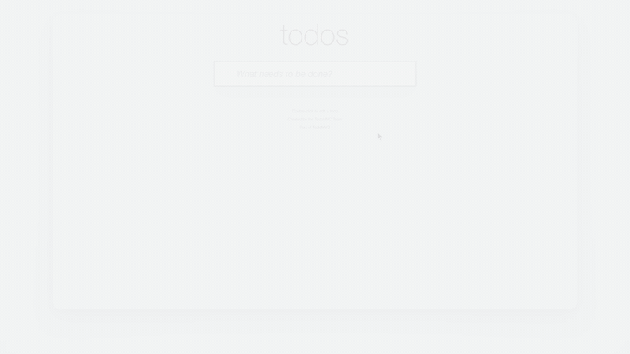

# todo-sample

A thirty second demo of a public todo app, made end to end with demo-studio. It is the smallest
complete example: three scenes, no login, no secrets, nothing to clean up afterwards.



**Mode:** our script
**Goal:** show what the plugin produces from a real app, with nothing staged
**App on screen:** the [TodoMVC](https://todomvc.com) React example, a public sample app. It is not ours.
**Recorded:** 2026-11-12, one take per scene

## What is here

| File | What it is |
| --- | --- |
| `SHOT-LIST.md` | The three scenes |
| `recordings/scenes/*.body.js` | The scene scripts that drove the browser |
| `recordings/scenes/_project.js` | Cursor and masking settings |
| `recordings/takes.csv` | The take log, each take marked `keep` |
| `demo.json` | The keynote-style cut: trims, speed, zoom, captions, cards |
| `handoff.json` | The promo cut for an editor: shots, voiceover lines, brief, claims |

The footage is not in the repo. Recording it again takes about two minutes.

## Record it yourself

From the folder you started Claude Code in, with the Playwright MCP set up (`P` is the plugin folder):

```bash
cp -R "$P/examples/todo-sample" demos/todo-sample && cd demos/todo-sample/recordings
mkdir -p raw frames exports && head -1 takes.csv > t && mv t takes.csv   # start a fresh take log
export PLAYWRIGHT_MCP_OUT="<the folder Claude Code started in>/.playwright-mcp"
node "$P/scripts/frame-receiver.mjs" .                      # leave running
bash "$P/scripts/mk-setup.sh" https://todomvc.com/examples/react/dist/
bash "$P/scripts/mk-scene.sh" 01-add-todos                  # then 02 and 03
```

Ask Claude to run each printed `.run.js` file with the Playwright MCP, check the frames, and encode
each take with `encode-take.sh`. Or just ask: "try demo-studio on the todo sample".

Then cut it:

```bash
cd .. && python3 -I "$P/scripts/review-reel.py" recordings --config demo.json
node "$P/scripts/title-cards.mjs" handoff.json && python3 -I "$P/scripts/build-handoff.py" handoff.json
python3 -I "$P/scripts/mk-assets.py" demo.json              # run the printed file with the MCP
python3 -I "$P/scripts/build-keynote.py" demo.json
python3 -I "$P/scripts/narrate.py" demo.json                # adds the voiceover (macOS say by default)
```

## Test sweep

| Path | How it was checked | Result |
| --- | --- | --- |
| Add three todos | Scene waits for each todo's text to appear | pass |
| Tick two, filter Active, Completed, All | Scene waits for "1 item left" | pass |
| Clear completed | Scene waits for the second row to be gone; one todo left | pass |
| The app URL | Opened fresh in a new browser context, no login | pass |

## Notes from this shoot

- The site shows a side panel about the framework on wide screens. It is not part of the app, so
  scene 01 hides it with one line of CSS before recording.
- The pointer clicks the right end of the input, so it does not sit on top of the text being typed.
- The app is small in a 1440 wide page. The raw takes are left unzoomed and `demo.json` zooms to
  1.7x in the edit.

## Status

- 2026-11-12: recorded, reviewed and cut. Nothing was created outside the page, so there are no throwaways.
